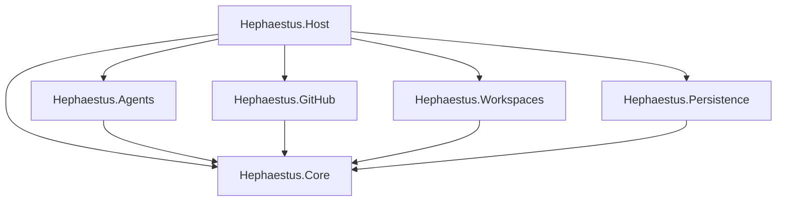
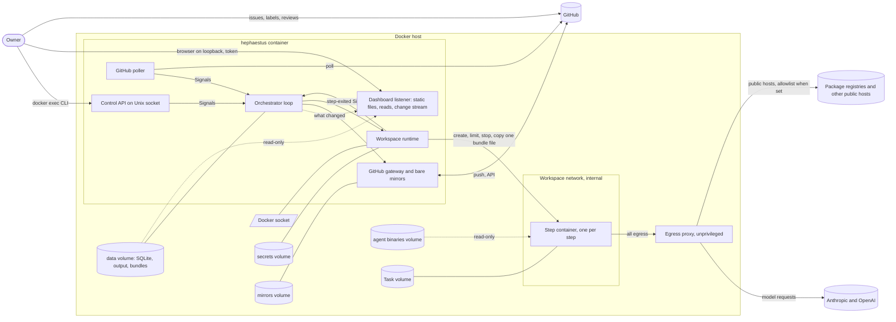
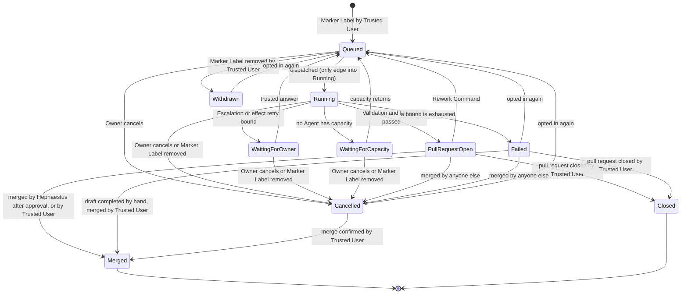
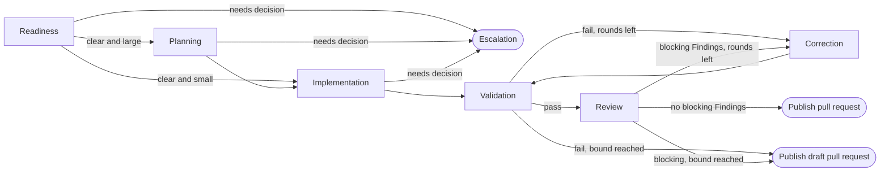
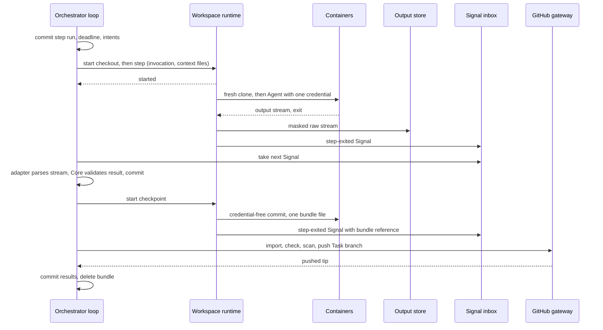
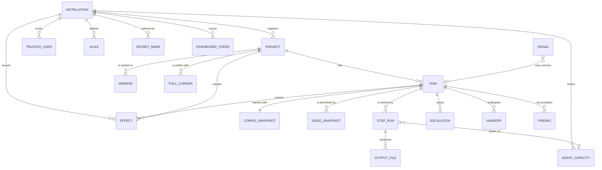

# Architecture Spine — Hephaestus

## Design Paradigm

**Hexagonal modular monolith.** One process hosts a core that owns the Task state machine and the orchestrator loop; everything that touches the outside world is an adapter behind a port the core defines. The loop follows a reconcile, admit, dispatch cycle and is the only writer of Task state. State is durable in SQLite; nothing needed for recovery lives only in memory.

| Layer | Project | Holds |
| --- | --- | --- |
| Core | `Hephaestus.Core` | Task and step model, state machine, orchestrator loop, policies (trust, queue order, author and Reviewer, bounds), ports, context assembly, Methodology model, result types, masker, configuration and command parsing |
| Adapter | `Hephaestus.Agents` | Claude Code and Codex CLI adapters |
| Adapter | `Hephaestus.GitHub` | The GitHub gateway: poller, API writes, bare mirrors, bundle import, push |
| Adapter | `Hephaestus.Workspaces` | Docker runtime: volumes, step containers, bundle exchange, checkpoints, agent binary volume |
| Adapter | `Hephaestus.Persistence` | SQLite through EF Core (Tasks, step runs, Signal inbox, effect journal, Installation Configuration, poll cursors), plus the output file store and the secret file store |
| Host | `Hephaestus.Host` | Composition root, control API, dashboard listener with the read API and the change stream, CLI entry point |
| Client | `Hephaestus.Dashboard` | The Dashboard: an Angular single-page application, built into static files the Host serves. Not a .NET project; it references none and none references it |

## Invariants & Rules



### AD-1 — Single-writer orchestrator over a durable Task state machine

- **Binds:** all modules; FR-8, FR-10, FR-14, FR-15, FR-21, FR-23, NFR-9, NFR-10
- **Prevents:** a second component mutating Task state; scheduling state that exists only in memory; Signals applied twice or half-applied; two Tasks running; a Task started without the code it depends on
- **Rule:**
  - Task and step-run records are written only by the orchestrator loop, through `IUnitOfWork`, which nothing else may depend on (asserted by a test).
  - Changes arrive only as Signals appended to a persisted inbox by the poller, the control API, and the runtime. The clock is not a Signal source: on each tick the loop compares recorded deadlines, resume conditions, and windows with `TimeProvider`.
  - One transaction per Signal: marking it applied, every Task and step-run write it causes, and the intents of the effects it causes commit together. Effects run only after that commit; each result is its own transaction.
  - Inbox order is a database-assigned integer sequence. Every Signal has a unique source and source event id; a duplicate append is a no-op. The poller appends first and advances its cursor second.
  - `Running` is entered only from `Queued`, by dispatch; at most one Task is `Running`. The lifecycle diagram is the complete transition table.
  - Dispatch order: Tasks whose last step run was interrupted, which ignore windows; then, inside an open window of their Project, Tasks with a Priority Label; then by issue number. Dispatch of a Task with no step run requires an open window record for its Project.
  - A Task with an unsatisfied declared dependency is never dispatched; it stays `Queued` and is passed over. A dependency is satisfied only when the Task it names, in the same Project, is `Merged`; nothing else satisfies it. Core parses declarations from the admitted issue snapshot (AD-15).
  - Every wait is a Task state with a recorded resume condition; every retry has a recorded count and bound. A step interrupted by a restart is never resumed in place: its container is removed, a checkpoint is taken (AD-9), and it is attempted again as a new step run.
  - Apart from the poller, no module acts on a timer. Startup recovery is the loop's first tick; output retention is a loop phase.

### AD-2 — Source of truth is split by who owns the fact

- **Binds:** orchestrator loop, GitHub gateway; FR-6, FR-11, FR-21, FR-44, FR-49
- **Prevents:** one builder treating the database as a cache of GitHub while another treats GitHub as a view of the database; intent inferred from present state so that an untrusted user can stop or restart a Task; a merge nobody trusted approved counting as finished work and releasing its dependents
- **Rule:** GitHub is authoritative for human intent, and intent is read only as actor-attributed events (labelled, unlabelled, closed, reopened, review submitted or dismissed, comment created or edited), each one Signal; it is never inferred from the current label set or open or closed state. SQLite is authoritative for execution state. State labels and comments written by Hephaestus are a one-way projection of the database and are re-asserted when changed by hand. Execution facts are read back from GitHub only to resolve an unfinished effect (AD-5). A Task is one Project and one issue number for life: opting in again is a Marker Label event by a Trusted User later than the cancellation, withdrawal, or failure, and it reuses the Task, its branch, and its pull request. A merge is read the same way, as an actor-attributed event: merged by Hephaestus after an approval, or by a Trusted User, the Task becomes `Merged`; merged by anyone else, it becomes `Cancelled`, the reason is reported on the issue, and Hephaestus never reverts the merge. A Trusted User accepts such a merge with the `confirm` command on the pull request, which moves the Task to `Merged`.

### AD-3 — Dependency direction is enforced by project references

- **Binds:** solution structure; all modules
- **Prevents:** provider-specific logic leaking into the core; adapters calling each other
- **Rule:** The diagram above is the complete set of allowed references. `Hephaestus.Core` references no adapter project and no Octokit, Docker, EF Core, or ASP.NET Core package; YamlDotNet and `System.Text.Json` are allowed there. Adapters reference only Core. Only `Hephaestus.Host` references adapters. Core defines these ports: `IAgentAdapter`, `IWorkspaceRuntime`, `ICodeHost`, `IUnitOfWork`, `IReadStore`, `ISignalInbox`, `IPollCursorStore`, `IOutputStore`, `ISecretStore`, `INotifier`, `IChangeFeed`. `Hephaestus.Persistence` implements the six storage ports; `Hephaestus.Host` implements `IChangeFeed` (AD-17). Two adapters cooperate only through Core.

### AD-4 — One GitHub gateway [ADOPTED]

- **Binds:** `Hephaestus.GitHub`; FR-4, FR-18, FR-44, NFR-2, NFR-6, NFR-7
- **Prevents:** a second path to GitHub that bypasses the journal, masking, or the credential boundary; a write to the Base Branch outside an approved merge
- **Rule:** `Hephaestus.GitHub` is the only code that talks to GitHub and the only holder of the GitHub App credential. It owns the mirrors and is the only code that pushes. The poller is its only background activity: it keeps cursors through `IPollCursorStore` and does nothing but append Signals. It never decides trust or changes a Task. It has no code path that pushes, force-pushes, or deletes any ref outside `hephaestus/*`; the only write to a Base Branch is a merge call that carries the approved head commit id. No GitHub credential, token, or authenticated remote URL is ever placed in a Workspace volume, a step container, or a context file.

### AD-5 — Effect journal: intent before effect, result after

- **Binds:** every module causing an effect outside the process; FR-21, FR-22, NFR-7, NFR-9, NFR-12
- **Prevents:** duplicate pull requests, comments, or Workspaces after a crash; effects with no audit record; two writers of the journal
- **Rule:** Only the loop writes the journal. Every effecting port method takes the idempotency key as a parameter; adapters neither journal nor derive keys. Effects are: push, pull request open and update, comment, label change, merge, issue creation, container, volume, and network creation and removal, notification. Reads (polling, lookups, probes) are not effects. On recovery an intent without a result is resolved by natural key before anything is retried: pull request by head branch, comment and created issue by hidden marker, label as a set operation, push as fast-forward, merge by pull request state, Docker object by label, removal by absence; a notification is not sent again. An effect that fails because the far side is unreachable is retried at a recorded next-attempt time within a bound while the Task keeps its state; at the bound the Task moves to `WaitingForOwner`, not `Failed`. An effect the far side refuses for good, for example because the issue was deleted or a permission withdrawn, is not retried: the refusal is journaled with its reason and the Task moves to `WaitingForOwner`. The journal is append-only and is the audit trail.

### AD-6 — Workspace shape: volume per Task, container per step, only the committed tree survives

- **Binds:** `Hephaestus.Workspaces`, lifecycle steps; FR-17, FR-18, FR-19, FR-20, FR-22, FR-31
- **Prevents:** a long-lived container accumulating both vendors' credentials; planted hooks, git configuration, or ignored files carrying over to a step that holds another credential or decides Validation
- **Rule:** A Task owns exactly one named Docker volume. Each step runs in a fresh container, removed when the step ends. Before every step a credential-free container re-creates `/workspace` from the bundle of the last pushed tip: a fresh clone with no hooks, default configuration, and no untracked or ignored files. Only `Implementation`, `Correction`, and `Rework` steps are checkpointed (AD-9); what any other step leaves in the tree is discarded. A step container receives only the credential of the Agent performing that step; a Validation, checkout, or checkpoint container receives none. Workspaces live only in named volumes, never in host bind mounts. The Task volume is removed, as a journaled effect, only when the Task has left `Running` and the journal shows its last checkpoint tip pushed; any later step re-creates it from the mirror.

### AD-7 — The container is the security boundary; only the orchestrator holds the Docker socket

- **Binds:** deployment, `Hephaestus.Workspaces`, agent adapters, Project Configuration schema; FR-17, NFR-2, NFR-3, NFR-4, NFR-5
- **Prevents:** a Task reaching the host, another Project, or the container runtime; reliance on an Agent's own sandbox; an Agent acting outside the container through the vendor account; two mechanisms enforcing one network rule; untrusted traffic handled by the process that holds the Docker socket
- **Rule:**
  - The Docker socket is mounted into the `hephaestus` container only. The orchestrator is root-equivalent on the host and is the trusted computing base.
  - A step container is created with exactly these mounts: the Task volume at `/workspace`, context, Methodology, and agent binaries read-only, a temporary `HOME`. No other volume: no cache, data, mirrors, or secrets volume. A Task volume is never mounted into the `hephaestus` container.
  - All capabilities dropped, `no-new-privileges`, the default seccomp profile, a process-count limit, no published port, fixed user `10001:10001`, time, processor, and memory limits set by the runtime.
  - Step containers cannot reach the host, loopback, link-local or private address ranges, or each other; only public egress leaves the workspace network.
  - The workspace network is a Docker internal network. Its only exit is the egress proxy: a separate, unprivileged container with no credential, no volume, and no Docker socket, never part of the `hephaestus` process. The proxy resolves names itself and refuses any destination that resolves to a loopback, link-local, or private address. Conditional on the injection spike (Open Questions 1).
  - Allowed egress hosts are set per step run and applied by host name. They are the list in the Task's configuration snapshot plus, only for a container that runs an Agent invocation, the hosts that invocation declares (AD-10). A Validation container gets the Project's list alone. With no Project list the proxy passes any public host.
  - In every step container the runtime sets the proxy variables in both cases, with loopback excluded, and configures git through environment variables to rewrite SSH remotes of `github.com` to HTTPS. It sets nothing specific to a language or build tool; such proxy settings belong to the Project image.
  - Hosts the proxy refused during a step run are recorded on that step run (AD-18).
  - Project Configuration can set the image, resource limits within the installation's, Validation commands, and allowed egress hosts, and nothing else about the container.
  - Inside a step container the Agent's own sandbox and permission prompts are off; no Agent safety mechanism is weakened anywhere else.
  - Every invocation disables tools that execute outside the step container under the vendor account's authority (account-linked connectors, remote MCP servers, cloud task delegation) and switches off repository-supplied executable Agent configuration (hooks, MCP servers, settings, plugins). An adapter that cannot guarantee this for an authentication mode declares that mode unsupported.

### AD-8 — Agent CLIs are pinned and supplied by Hephaestus, not baked into Project images

- **Binds:** release packaging, `Hephaestus.Workspaces`, `Hephaestus.Agents`, Project Configuration; FR-5, FR-24, FR-26, NFR-15
- **Prevents:** adapter and CLI version drift; each Project pinning its own CLI version; redistributing vendor binaries
- **Rule:** Each Hephaestus release pins one version and checksum of each Agent CLI per platform in `deploy/agents.lock`. Hephaestus images contain no Agent binary: at startup the orchestrator downloads the pinned binaries from the vendor's official channel, verifies them, and fills the agent binaries volume, which is mounted read-only into the image the Project Configuration names. The Project image contract is: Linux, glibc or musl, `bash` present. The configuration snapshot records the image digest resolved at Task start and every step of the Task runs that digest. CLI self-update is disabled in step containers. An adapter runs only against the CLI version it was released with. Conditional on the injection spike (Open Questions 1); the fallback keeps the same rule with a Hephaestus base image that Project images derive from.

### AD-9 — Bundle boundary and checkpoints

- **Binds:** `Hephaestus.Workspaces`, `Hephaestus.GitHub`, lifecycle steps; FR-4, FR-18, FR-20, FR-30, FR-44
- **Prevents:** code execution in the process that holds the GitHub credential and the Docker socket; lost work on interruption; attribution by guesswork; a secret pushed inside a commit
- **Rule:**
  - Code enters and leaves a Workspace only as a git bundle. The orchestrator never runs git or any other tool in an agent-writable directory. Mirrors are bare, with no hooks and no working tree; anything that needs a working tree runs in a Workspace.
  - A checkpoint follows every checkpointed step, including one ended by timeout, crash, or cancellation. The checkpoint container never uses the volume's `.git`: it builds its own git directory from the last pushed tip outside the Task volume, takes `/workspace` as work tree only, and writes exactly one commit whose parent is the last pushed tip. Commits an Agent made during the step are flattened into it. An unchanged tree makes no commit and no push. Core supplies the whole commit message and identity.
  - A bundle leaves a container as one regular file of bounded size under a name the runtime chose, read from a stopped container; any other archive content is an `infrastructure-error`. It crosses ports as a bundle reference (path on the data volume, checksum, tip, prerequisite) that the producer writes, the consumer reads, and the loop deletes once the push result is journaled.
  - The gateway imports the bundle into a quarantine ref with strict object checking before any other ref moves, accepts only the Task branch, verifies it is a fast-forward of the last pushed tip, scans every new blob and commit message with the masker (AD-16), and pushes. A failed check blocks the push, keeps the Workspace, and raises an Escalation. Task branches are pushed fast-forward only. When the Task branch on GitHub is not at the tip Hephaestus last pushed, no step runs on it and nothing is pushed: the Task is held in `WaitingForOwner` until a Trusted User's `confirm` adopts the remote tip as the last pushed tip.
  - Each step run records the tip before and after it; attribution is read from those records, never from commit content.

### AD-10 — Agent adapters are pure

- **Binds:** `Hephaestus.Agents`, `Hephaestus.Workspaces`; FR-24, FR-25, FR-26, FR-27, FR-30
- **Prevents:** Docker calls inside adapters; vendor flags inside the runtime or the core; secret values in the database
- **Rule:** An `IAgentAdapter` does five things: describes the invocation for a step, describes a probe that checks the CLI is present, authenticated, and has capacity, parses a stored output stream into normalized events, produces a normalized result with usage where reported, and classifies a CLI that exited by itself. An invocation is a fixed record: argument vector, environment, secret references, files, the egress hosts the CLI needs in that authentication mode, and where the result is found. It carries secret references (a name and a target variable or file path), never values; only the runtime resolves a reference, through `ISecretStore`, when it starts the container. Adapters start no process and know nothing about Docker; the runtime knows nothing about Agents. The adapter selects the invocation by the Agent's authentication mode. Capabilities a CLI lacks are declared absent and reported, never imitated. Alias resolution happens in Core; mapping to vendor flags happens in the adapter. Effort is a closed Core set that each adapter maps or declares unsupported, checked at intake.

### AD-11 — Failure classes, their precedence, and the two bounds

- **Binds:** adapters, runtime, state machine, history, Owner-facing text; FR-19, FR-27, FR-34, NFR-10, NFR-11
- **Prevents:** per-adapter failure vocabularies; an unrecognised failure treated as a Usage Limit; a step classified twice; one bound spent for another's cause
- **Rule:** Every failed step run carries exactly one of: `usage-limit`, `timeout`, `agent-error`, `validation-failure`, `infrastructure-error`, `cancelled`, `unknown`. The class is decided in one order: the runtime's cause first (`cancelled`, `timeout`, and out-of-memory or Docker faults as `infrastructure-error`), then the adapter's reading of a CLI that exited by itself, then Core (`agent-error` for a missing or invalid result). A step run interrupted by a restart is `infrastructure-error`. Anything not positively identified is `unknown`. There are two bounds: failed Validation and blocking Findings spend Correction rounds; `timeout`, `agent-error`, `infrastructure-error`, and `unknown` spend the step retry bound of that step kind. Exhausting either ends in `Failed`. `usage-limit` spends neither and is the only class that leads to Handoff or `WaitingForCapacity`; Handoffs per Task have their own bound. `cancelled` ends in `Cancelled`.

### AD-12 — Steps are artifact-sufficient; context travels as files

- **Binds:** lifecycle steps, adapters, Methodology templates; FR-28, FR-62, FR-65, NFR-1
- **Prevents:** a separate, rarely exercised Handoff path; per-Agent prompt assembly; dependence on vendor session state
- **Rule:** Every step is executable from the context files and the repository state alone, in a fresh Agent session. Session resume is not used; it may only ever be added as an optimisation on which correctness does not depend. Core assembles one context file set per step run under the fixed names in Consistency Conventions; the runtime places it read-only; the adapter's prompt is one fixed sentence pointing at `instruction.md`. An input that does not exist is an absent file. Start, correction, rework, and Handoff use the same mechanism. The handoff summary is assembled by Core from recorded data; no Agent writes it. The plan lives in the database and is rendered into the pull request description; it is not committed. Only content admitted under AD-15 enters a context file.

### AD-13 — Step results are validated documents; Validation alone decides acceptability

- **Binds:** lifecycle steps, adapters; FR-9, FR-31 to FR-35, FR-48, FR-63, FR-65
- **Prevents:** free-text parsing; an Agent's claim deciding an outcome; a step that needs a decision having no way to say so; the Reviewer reviewing its own work
- **Rule:** Results by step kind: `Readiness` gives a readiness verdict; `Planning` gives a plan; `Implementation`, `Correction`, and `Rework` give an implementation summary; `Review` gives Findings, each blocking or non-blocking. Every result has an outcome of `completed` or `needs-decision`; `needs-decision` carries questions and options and becomes an Escalation from any Agent step. Result types are Core records restricted to what both CLIs' schema-constrained output accepts; each adapter adapts the generated schema to its CLI. Core validates every result by strict deserialization; a missing or invalid result is an `agent-error` and is never interpreted. Core gives each Finding an id; a Review after a Correction returns the status of every open Finding plus any new ones. Whether work is acceptable is decided only by the exit status of the Project's Validation commands, each run by the runtime in a credential-free container on a fresh checkout, and by the Reviewer's Findings. The author is the Agent of the latest checkpointed step run that changed the tree; the Reviewer is the other of the Task's two Agents; `primary` and `fallback` must resolve to different Agents or the Task does not start. Correction goes to the author.

### AD-14 — Methodology is data, read from the Base Branch

- **Binds:** Core, lifecycle steps; FR-61 to FR-66
- **Prevents:** per-Methodology code paths in the orchestrator; different instructions for different Agents; a Task branch rewriting the workflow its Reviewer follows
- **Rule:** A Methodology is a directory with a manifest and one instruction template per Agent step kind. `default` and `bmad` ship in the Hephaestus image. Core selects a template by step kind only and never branches on the Methodology name or on the Agent. Templates contain no substitution and refer only to context file paths; the same `instruction.md` goes to whichever Agent performs the step, and each step run records the Methodology name and template identity. Methodology files a Project supplies are read from the Base Branch at the commit of the Task's configuration snapshot and placed read-only at `/hephaestus/methodology`; templates refer to that path, never to a copy in `/workspace`.

### AD-15 — Trust is decided once, on the way in

- **Binds:** GitHub gateway, Core admission policy, context assembly; FR-6, FR-45, FR-49, NFR-1
- **Prevents:** trust checks scattered across handlers; untrusted text reaching an Agent; trust attached to a login that can change hands
- **Rule:** The gateway attaches the acting GitHub user's numeric id to every inbound Signal, taken from GitHub's own event data, never from content. One admission function in Core decides whether that id is a Trusted User; a login is display only. Signals from anyone else are recorded and change no Task; the one exception is a merge, which cancels the Task (AD-2). A label action by anyone else is also reported on the issue, once per user, kind of action, and issue; their comments and commands get no reply, because a reply per account would let outsiders fill a thread. The issue title and body are snapshotted as vouched for by the Marker Label event; a title, body, or comment is admitted only when its author, for comments, and every later editor are Trusted Users, and a later edit by anyone else holds the Task for confirmation by a Trusted User, given with the `confirm` command. An edit is detected by comparing a hash of the content with the hash recorded when it was admitted, never by relying on an edit event having been seen. The editor is read from GitHub's edit history; an edit whose editor cannot be established counts as made by someone who is not a Trusted User. Hephaestus's own identity is never a Trusted User and its content is never admitted. Commands are parsed by one parser in Core.

### AD-16 — Configuration split, snapshot, secrets, and masking [ADOPTED]

- **Binds:** Project Configuration, Installation Configuration, secrets; FR-2, FR-3, FR-4, FR-25, NFR-5
- **Prevents:** a Task branch changing the rules of its own run; a repository raising a limit; secrets in the database, a repository, or output
- **Rule:**
  - Project Configuration is `hephaestus.yml` at the repository root, returned by the gateway as raw bytes with its commit id from the Base Branch only, parsed and validated in Core, and snapshotted onto the Task when it starts.
  - Installation Configuration lives in SQLite: registered Projects with their Base Branch, Schedules, Trusted Users, Aliases, limits, protected paths, Agent authentication modes, notification channels, the installation's language, and Dashboard Token hashes. API handlers write it directly in their own transaction; the loop reads it at the start of each tick. A repository value can never raise an installation limit.
  - Secret values live as files on a volume mounted only into the `hephaestus` container; the database holds secret names. Values are entered through standard input only. No value is written to the journal, a step-run record, a Docker label, or a container name. Nothing produced by a step container is ever written to the secrets volume.
  - Hephaestus implements no sign-in flow: the Owner signs in with the vendor's own tool and supplies the resulting credential.
  - The masker is one Core service built from `ISecretStore` and rebuilt when a secret changes. It matches across chunk boundaries and each value's base64 and URL-encoded forms, and is applied where text is written: by the runtime before raw output reaches `IOutputStore`, by the gateway before every outbound body and before every push (AD-9), and by the logger.

### AD-17 — One host process; the CLI and the Dashboard are API clients

- **Binds:** `Hephaestus.Host`, `Hephaestus.Dashboard`, CLI, deployment; FR-3, FR-16, FR-54, FR-55, FR-67, FR-68
- **Prevents:** a second writer on the SQLite file; CLI logic bypassing the loop or the journal; a browser, a web page the Owner visits, or a stolen token changing anything; the process that holds the Docker socket answering a Workspace or another machine; a view that is silently stale; a second, two-way protocol beside the API
- **Rule:**
  - One long-running container named `hephaestus` hosts the orchestrator loop and an HTTP API with two listeners.
  - The **control listener** is a Unix domain socket inside that container. It carries the whole API and is the only place an endpoint that appends a Signal, changes configuration, issues or revokes a Dashboard Token, or touches a secret is mapped. The CLI is the same executable in client mode, run with `docker exec`, and does nothing except call it. Everything that affects a Task or a Project's work is a Signal: the endpoint returns 202 with the Signal id, and the Signal's status reports pending, applied, or rejected with problem details.
  - The **dashboard listener** is TCP. It serves the Dashboard's static files and read endpoints only; a test fails when an endpoint that is not a read is mapped on it. It is published on the host's loopback address only, and the `hephaestus` container shares no Docker network with the egress proxy or with any step container. It refuses a request whose host name is not one of the loopback names it was configured with.
  - Every read endpoint and the change stream require a Dashboard Token in a request header. The Dashboard uses no cookie, and a token never appears in an address. Tokens are Installation Configuration (AD-16): written through the control listener, stored only as a hash, shown once when issued, never logged. Revoking a token takes effect on the next request and closes every stream opened with it.
  - Reads on either listener go through `IReadStore`, which `Hephaestus.Persistence` implements on a read-only SQLite connection, and through `IOutputStore`. No endpoint depends on `IUnitOfWork` (AD-1).
  - The Dashboard is a single-page application built when the image is built and served as static files. It loads nothing from another origin, and the listener sends a content security policy that allows no other origin and no inline script. It renders text from GitHub and from Agents as text, never as markup; a lint rule forbids bypassing the framework's escaping.
  - The Dashboard learns of changes from one **change stream**, a read endpoint that answers with Server-Sent Events. After each committed transaction the loop, and a control API handler after its own, announces what changed through `IChangeFeed`. An event names a scope (`task`, `project`, or `installation`) and an id, never content; the Dashboard then reads what it shows through the read endpoints, and reads everything on screen again whenever the stream reconnects. An announcement is not an effect and is not journaled (AD-5). The number of open streams is bounded, and a stream that falls behind is closed. Keeping a stream open is transport, not a module acting on a timer (AD-1).
  - No channel on which a browser can send exists. Agent output is not streamed while a step runs (AD-18).
  - The Dashboard is not reachable from another machine in v1.

### AD-18 — The loop never awaits a step

- **Binds:** orchestrator loop, `Hephaestus.Workspaces`, `Hephaestus.Agents`; FR-11, FR-19, FR-23, FR-48
- **Prevents:** the single writer parked inside a running step so that cancels, labels, and answers wait for it; no defined place where the adapter meets the output stream; two components enforcing one deadline
- **Rule:** `IWorkspaceRuntime` starts a step and returns when the container is created. The runtime writes the raw stream through the masker to `IOutputStore` and appends exactly one step-exited Signal carrying the step-run id, the exit code, the runtime's cause, and the hosts the egress proxy refused. Applying that Signal, the loop gives the stored stream to the adapter, validates the result, and writes the step run. A step run records its deadline before its container starts; the runtime alone stops a container at its deadline, and stopping a step is the only way to end one early. Checkout, Validation, checkpoint, and probe containers follow the same contract. One output file per container run; each Validation command is its own container run.

### AD-19 — A Task branch is untrusted code in a trusted repository

- **Binds:** GitHub gateway, Project registration, pull request and comment composition; FR-44, NFR-2, NFR-6
- **Prevents:** Agent-written code gaining repository secrets or write access through the repository's own automation; forged Hephaestus markers; Agent text triggering GitHub behaviour
- **Rule:** The GitHub App is granted contents, issues, and pull requests read and write, and metadata, checks, and statuses read; never `workflows` or administration. The gateway does not push a bundle whose diff against the Task's start commit touches a protected path; the default protected paths are `.github/**` and `hephaestus.yml`, the list is Installation Configuration, and a hit raises an Escalation and keeps the Workspace. Registering a Project reports whether the Base Branch is protected against direct pushes. Agent-derived text is neutralised before it is posted: HTML comments are escaped, mentions and issue-closing keywords are broken, command keywords are fenced. A hidden marker or a pull request counts for recovery only when written by Hephaestus's own identity and matched by a journaled intent.

### AD-20 — Capacity is a fact about an Agent, not a failure of a Task

- **Binds:** dispatch, adapters, runtime; FR-26, FR-27, FR-29, NFR-12
- **Prevents:** the next Task dispatched to an Agent already known to be exhausted or unavailable; an outage walking a Task to `Failed`
- **Rule:** Capacity is recorded per Agent credential (exhausted until, last probe), not on the Task that met the limit. Dispatch consults it before choosing an Agent. An Agent found unavailable or without capacity by a probe has no capacity: that is not a failed step run and AD-11 does not govern it. A probe is an invocation the adapter describes and the runtime runs with no Task volume. A Task in `WaitingForCapacity` does not hold the single slot and returns to `Queued` when capacity returns.

### AD-21 — Language is data; the machine surface has one language

- **Binds:** Core, `Hephaestus.Host`, GitHub gateway text, `Hephaestus.Dashboard`, context assembly; FR-69, NFR-17
- **Prevents:** a sentence built by concatenation in an adapter or a handler; a translated label, command, or JSON key; two modules deciding the language differently; a second set of Methodology templates per language
- **Rule:**
  - Every sentence Hephaestus produces for a person is a message id with parameters, resolved in Core from resource files for `en` and `pl`. Adapters and API handlers pass ids and parameters; none composes prose. A test fails when an id has no entry in a supported language.
  - The language is resolved by one Core function. For text on GitHub and for Agent prose it is the Task's configuration snapshot (the Project's `language` key, else the installation's), or the Project's when no Task exists. For the command line and Notifications it is the installation's. For the Dashboard it is the browser's choice, else the installation's.
  - Never translated: command names and options, `--json` output, problem `type` values, label and state names, comment-command verbs, `Depends-On:`, hidden markers, commit trailers, configuration keys, log lines, and Glossary terms.
  - `task.json` carries the Task's language. Methodology templates stay single-language and contain no substitution (AD-14); they instruct the Agent to write the prose fields of its result in the language `task.json` names.
  - The Dashboard ships both languages in the image; switching needs no rebuild and no request to another origin (AD-17).

## Consistency Conventions

| Concern | Convention |
| --- | --- |
| Vocabulary | PRD Glossary terms are the type and member names: `Task`, `Project`, `Workspace`, `Finding`, `Escalation`, `Handoff`. |
| Task states | `Queued`, `Running`, `WaitingForOwner`, `WaitingForCapacity`, `PullRequestOpen`, `Failed`, `Cancelled`, `Withdrawn`, `Merged`, `Closed`. |
| Step kinds | Agent steps: `Readiness`, `Planning`, `Implementation`, `Review`, `Correction`, `Rework` (v0.3). Runtime step: `Validation`. Publishing and merging are effects of the loop, not step runs, and do not take the single slot. |
| Identity | A Project is identified by GitHub repository id, a user by numeric id; names and logins are display only. Entity ids are UUID version 7, stored as text. |
| Time | UTC everywhere; stored as fixed-width ISO 8601 text through one value converter so that string order is time order. Core reads time only from `TimeProvider`. |
| JSON and YAML | camelCase keys; enums as kebab-case strings; `System.Text.Json`. Usage fields are nullable; absent is never stored as zero. |
| API errors | RFC 9457 problem details. |
| Async | Every I/O method is async and takes a `CancellationToken` as its last parameter. |
| Ports and adapters | Ports are `I<Name>` in `Hephaestus.Core.Ports`. Adapters are `<Vendor><Port>` (`ClaudeCodeAgentAdapter`, `DockerWorkspaceRuntime`). |
| Labels | Marker `hephaestus`; state `hephaestus:<state>` in kebab-case; roles `primary:<alias>`, `fallback:<alias>`, `effort:<alias>`. |
| Commands | A comment by a Trusted User whose first line is `/hephaestus <verb>`. Verbs are a closed set: `confirm` in v0.1; `rework` and others are added by the release that needs them. `confirm` on an issue accepts held content (AD-15); on a pull request it accepts a merge made by someone who is not a Trusted User (AD-2); on either it accepts commits on the Task branch that Hephaestus did not push, adopting the remote tip as the last pushed tip (AD-9). |
| Dependency declaration | A line `Depends-On: #<issue-number>` in the issue body, one per dependency, naming an issue of the same Project. Read from the admitted snapshot only. |
| Branch name | `hephaestus/<issue-number>-<slug>`, derived once and stored on the Task. |
| Idempotency key | `<scope>:<cause>:<effect-kind>:<ordinal>`. Scope is a Task id, `project:<id>`, or `installation`. Cause is `s<step-run-sequence>` or `g<signal-sequence>`. |
| Hidden marker | `<!-- hephaestus:effect=<idempotency-key> -->` as the last line of every comment and created issue body. |
| Commit message | Composed by Core with trailers `Hephaestus-Task`, `Hephaestus-Step`, `Hephaestus-Agent`, `Hephaestus-Model`, `Hephaestus-Effort`; informational only. The committer is the Hephaestus GitHub identity. |
| Step container layout | Repository at `/workspace`; context at `/hephaestus/context`; Methodology at `/hephaestus/methodology`; agent binaries at `/hephaestus/agents`; `HOME` at `/hephaestus/home`, discarded with the container. |
| Context files | `instruction.md`, `task.json` (ids, branch, start commit, Base Branch, step kind, round, language), `issue.md`, `comments.json`, `plan.md`, `findings.json`, `validation.json`, `handoff.md`, `result.schema.json`. |
| Docker objects | Every container, volume, and network carries labels `hephaestus.installation`, `hephaestus.task`, and `hephaestus.step-run`; names start with `hephaestus-`. Recovery and cleanup select on the installation label. |
| Helper containers | Checkout and checkpoint containers run the `hephaestus-tools` image (git only), never the Project image. |
| Persistence | One `DbContext` and one migration set; SQLite in write-ahead-log mode with a busy timeout; copies and backups are made with SQLite's backup operation with the loop stopped. |
| Logging | `Microsoft.Extensions.Logging`, JSON to stdout, with `taskId` and `stepRunId` scopes, through the masker. |
| Agent output | Raw streams are files on the data volume, indexed in SQLite, removed by retention (default 30 days); structured history stays in SQLite. |
| Bounds | Every loop, retry, and wait reads its limit from configuration with a default; none is unbounded. Correction rounds (default 2) come from the Project Configuration snapshot. Step retries (default 2), Handoffs per Task, effect retries, the probe schedule, the polling interval, output retention, and open change streams (default 8) are Installation Configuration. |
| Build | Nullable reference types on, warnings as errors, central package management in `Directory.Packages.props`. |
| Branches and checks | Two protected branches: `develop`, the default, and `main`. Every change arrives by pull request: features into `develop`; `develop`, or a `hotfix/*` branch, into `main`. GitHub Actions builds and tests every pull request. The build fails below 80% line coverage in the .NET solution and in the Angular workspace, with exclusions kept in one file, each with a reason. SonarQube Cloud analyses every same-repository pull request and both branches, and its built-in quality gate (80% coverage on new code) must pass. These checks are required before a merge (NFR-18). |
| Analysis credential | No SonarQube token is stored. The workflow uses SonarQube Cloud's secretless analysis: a GitHub-issued OpenID Connect token is exchanged for a credential that lasts thirty minutes and can only submit an analysis for this project. The job's permissions are `id-token: write` and `contents: read`. |
| Releases and channels | One file states the version. A pull request to `main` fails unless that version is a valid three-part Semantic Version, higher than the last one published, and present in `CHANGELOG.md`. A merge to `main` creates the tag `v<version>` and publishes both images under it; a version with a pre-release identifier does not move the stable tags. A merge to `develop` publishes `develop` and `develop-<short commit id>`. |
| Tests | Adapters are tested against recorded CLI transcripts tagged with the CLI version. A scripted fake `IAgentAdapter` drives end-to-end tests with no vendor call. Persistence and runtime tests use real SQLite and Docker through Testcontainers. The dashboard listener is tested over HTTP for token, host name, and read-only rules. |
| Public surface | Configuration schema, label and command conventions, CLI, and image tags are versioned under SemVer; a change to any is a changelog entry grouped as added, changed, fixed, removed, security. The Dashboard and the HTTP API are not part of the versioned surface in v1: they ship in the same image and always match. The `develop` image tags are a preview channel outside the versioned surface. |
| Dashboard API | On the dashboard listener, read endpoints live under `/api` and the change stream is `/api/changes`; every other path serves the Dashboard. The container port is 8717, published as `127.0.0.1:8717`. A change event is `{ "scope": "task" \| "project" \| "installation", "id": "<id>" }`. |
| Dashboard build | An Angular CLI workspace in `src/Hephaestus.Dashboard`; npm with a committed lockfile; unit tests with the CLI's runner. Built in a Node.js stage of `deploy/Dockerfile`; the runtime image holds the static files and no Node.js. |

## Stack

| Name | Version |
| --- | --- |
| .NET (LTS) and ASP.NET Core | 10.0 (runtime 10.0.15) |
| C# | 14 |
| Entity Framework Core with SQLite provider | 10.0.15 |
| Octokit | 14.0.0 |
| Docker.DotNet.Enhanced | 4.4.1 |
| System.CommandLine | 2.0.15 |
| YamlDotNet | 18.1.0 |
| xunit.v3 | 4.0.3 |
| NSubstitute | 6.2.0 |
| Testcontainers | 4.17.0 |
| Angular (with Angular CLI) | 22.3.0 |
| TypeScript | 6.0.3 (Angular 22.3 accepts 6.0.x only) |
| Node.js (build stage only; not in the runtime image) | 26.13.1 LTS |
| Vitest | 5.1.2 |
| SonarQube Cloud, with the scanner for .NET and secretless analysis | hosted service; scanner and action versions pinned by the quality-gate story |
| Git (orchestrator and tools images) | 2.48 or later (2.56.1 current) |
| Docker Engine with Compose v2 | 29.0 or later |
| Claude Code CLI | 2.1.332 at authoring; `deploy/agents.lock` is the authority |
| Codex CLI | 0.172.0 at authoring; `deploy/agents.lock` is the authority |

## Structural Seed

### Runtime topology



### Task lifecycle



A Task stays `Running`, and holds the single slot, across all its steps. A trusted issue close moves a Task to `Closed` from any state that is not final. Before v0.3 a Trusted User merges on GitHub and the merge arrives as a Signal. Only `Merged` satisfies a dependency (AD-1); a Task cancelled by someone else's merge satisfies none until a Trusted User confirms that merge (AD-2). A Task that fails with no commit ahead of its start commit gets an issue comment and no pull request; otherwise a failed Task gets a draft pull request.

### Steps inside Running



### One checkpointed step across the boundary



### Core entities



### Source tree

```text
hephaestus/
  src/
    Hephaestus.Core/          # domain, state machine, loop, policies, ports, result types, masker
    Hephaestus.Agents/        # ClaudeCode/, Codex/ adapters and stream parsers
    Hephaestus.GitHub/        # gateway, poller, mirrors
    Hephaestus.Workspaces/    # Docker runtime, bundle exchange, checkpoints
    Hephaestus.Persistence/   # DbContext, migrations, output and secret file stores
    Hephaestus.Host/          # Program, control and read API endpoints, dashboard listener, CLI commands
    Hephaestus.Dashboard/     # Angular workspace; built into the static files the Host serves
  methodologies/
    default/                  # manifest and step templates
    bmad/
  tests/                      # one test project per source project, plus end-to-end
  deploy/
    compose.yaml              # the hephaestus service, named volumes, workspace network, loopback port
    Dockerfile                # hephaestus image, with a Node.js stage that builds the Dashboard
    tools.Dockerfile          # hephaestus-tools image (git only)
    agents.lock               # pinned Agent CLI versions and checksums
  docs/
```

### Deployment and operations

- **Environments:** one, the Owner's installation. Development uses the same Compose file with a locally built image and its own installation id.
- **Images:** `hephaestus` and `hephaestus-tools` on GHCR, built for linux/amd64 and linux/arm64 by GitHub Actions. A merge to `main` publishes the version the repository states; a pre-release version gets its own tag. A merge to `develop` publishes the `develop` preview channel.
- **Build-time services:** GitHub Actions, GHCR, and SonarQube Cloud build and check Hephaestus's own repository. None is needed to run an installation (NFR-15).
- **Volumes:** `hephaestus-data` (SQLite, agent output, bundles, pre-migration copies), `hephaestus-secrets`, `hephaestus-mirrors`, `hephaestus-agents`, and one `hephaestus-ws-<task-id>` per Task.
- **Egress proxy:** one unprivileged container attached to the internal workspace network and to a network with outbound access; step containers are attached to the workspace network only. Whether it is a Compose service or created by the orchestrator is Deferred.
- **Startup:** back up the database, run migrations, stop on failure leaving the backup; fetch and verify pinned Agent binaries; then the loop's first tick resolves unfinished effects and step runs.
- **Dashboard:** served by the `hephaestus` container on port 8717, published as `127.0.0.1:8717` on the host. The container is on a network of its own; it is not attached to the workspace network or to the egress proxy's outbound network.
- **Continuous integration:** GitHub Actions also builds and tests the Angular workspace on every pull request, and the license check covers its npm packages (NFR-15).
- **Health and status:** the API reports loop liveness and the last tick; `status` names the running Task and step, waiting Tasks with their reason, and the Queue order.
- **Backup:** the data volume and the secrets volume are the whole installation state.
- **External providers:** GitHub (App identity, polled with conditional requests), Anthropic and OpenAI (reached only by the Agent CLIs from step containers, and at startup to fetch the pinned binaries). No other service is required.

## Capability → Architecture Map

| Capability / Area | Lives in | Governed by |
| --- | --- | --- |
| Project setup and configuration (FR-1 to FR-5) | Core, GitHub, Persistence, Host | AD-7, AD-8, AD-16, AD-17, AD-19 |
| Task intake, trust, Readiness (FR-6 to FR-11) | Core, GitHub | AD-1, AD-2, AD-13, AD-15 |
| Scheduling (FR-12 to FR-16) | Core | AD-1, AD-17, AD-20 |
| Workspace and execution (FR-17 to FR-23) | Workspaces, Core | AD-1, AD-5, AD-6, AD-7, AD-9, AD-18 |
| Agents, Handoff, attribution (FR-24 to FR-30) | Agents, Core | AD-8, AD-9, AD-10, AD-11, AD-12, AD-20 |
| Validation, Review, Correction (FR-31 to FR-35) | Core, Workspaces | AD-6, AD-11, AD-13 |
| Pull requests and Stacks (FR-36 to FR-40) | Core, GitHub | AD-4, AD-5, AD-9, AD-19 |
| Approval and merge (FR-41 to FR-44) | Core, GitHub | AD-2, AD-4, AD-15 |
| Rework (FR-45 to FR-47) | Core, GitHub | AD-1, AD-12, AD-15 |
| Escalation and Notification (FR-48 to FR-51) | Core, GitHub, a notifier adapter | AD-5, AD-13, AD-15 |
| Visibility and history (FR-52 to FR-55) | Core, Persistence, Host, Dashboard | AD-2, AD-5, AD-17 |
| Task authoring aid (FR-56, FR-57) | Repository assets, no runtime module | Public-surface convention |
| Distribution and versioning (FR-58 to FR-60) | Host, deploy | AD-8, AD-17, deployment seed |
| Methodology (FR-61 to FR-66) | Core, methodologies | AD-5, AD-12, AD-13, AD-14 |
| Dashboard (FR-67, FR-68) | Host, Dashboard, Persistence | AD-1, AD-16, AD-17 |
| Language (FR-69) | Core, Host, GitHub, Dashboard | AD-12, AD-14, AD-16, AD-21 |
| Engineering quality (NFR-18) | Repository, continuous integration | Branches and checks, Analysis credential, and Releases and channels conventions |
| Security (NFR-1 to NFR-8) | All | AD-4, AD-6, AD-7, AD-9, AD-15, AD-16, AD-19 |
| Reliability (NFR-9 to NFR-12) | Core, Persistence | AD-1, AD-5, AD-11, AD-20 |
| Data and observability (NFR-13, NFR-14) | Persistence, Host | Logging and agent-output conventions |
| Openness and footprint (NFR-15 to NFR-17) | All | AD-8, Stack, deployment seed |

## Deferred

| Decision | Why it can wait | Decided in |
| --- | --- | --- |
| Which egress proxy is used, how it is started and given each step run's allowed hosts, how its refusals are collected, SSH rewrites for hosts other than `github.com`, and how step containers stay unreachable from each other on a network they share with it | The mechanism and its rules are fixed (AD-7); the rest is contained in `Hephaestus.Workspaces` and `deploy/`. Docker object labels already allow a network per step run. | v0.1 execution epic spine |
| What the Owner is told, and what happens to the Task, when a declared dependency failed, was closed without a merge, is not a Task, or is part of a cycle; what opting in again means for a Task cancelled by an untrusted merge | Such a Task is never dispatched (AD-1); only its reporting is open. A cancelled Task with a merged pull request reaches `Merged` by confirmation (AD-2). | Intake epic spine |
| Usage Limit detection signals and capacity probing detail | Signals are undocumented; needs the spike. The class and the capacity record already exist (AD-11, AD-20). | v0.2 epic spine |
| Notification channels (ntfy, SMTP) and the project that implements `INotifier` | No other module depends on its shape; until then the port has a no-op in Host. | v0.2 epic spine |
| Schedule evaluation and time zone handling | Contained in one Core policy; windows are already records (AD-1). | v0.2 epic spine |
| Stack update after Rework and after merge (rebase or merge, squash or merge commit, any exception to fast-forward-only); relaxing dependency satisfaction from `Merged` to "has produced a branch" | Stacks do not exist before v0.3; AD-1 and AD-9 hold until then. | v0.3 epic spine |
| When admitted content is read again for the hash comparison of AD-15 | Safety does not depend on it: context files are built only from the admitted snapshot (AD-12), so an unnoticed edit never reaches an Agent. | Intake epic spine |
| Priority Label spelling; independence detection | One feature each; must extend the Labels convention. | Intake and v0.3 epic spines |
| Story-to-issue identity and drift handling (FR-66) | Contained in the Methodology epic. Fixed already: issue creation is a Project-scoped journaled effect, the hidden marker carries a stable Story identity declared by the Methodology manifest, and nothing is written back to the Base Branch. | Methodology epic spine |
| Which BMAD workflow serves each step kind | Template content, not structure (AD-14); needs the BMAD spike. | Methodology epic spine |
| Spend limit accounting (NFR-5); a size limit on Task volumes | Depends on what each CLI reports; usage is already normalized (AD-10). | v0.2 epic spine |
| OpenTelemetry export | Structured logs satisfy NFR-14. | When a second deployment mode exists |
| Agent Client Protocol | Both CLIs are reached through adapters only; `IAgentAdapter` is narrow enough to back with it later. | When a third Agent is added |
| Remote access to the Dashboard, encryption in transit, more than one user | In v1 the dashboard listener is on loopback only, behind a token (AD-17). | Server Mode |
| Other database engines | SQLite only in v1; EF Core keeps the option. | After v1 |
| Actions from the Dashboard | Read-only in v1. An action would be a Signal like any other (AD-17), with protection against cross-site requests designed first. | After v1 |
| Dashboard component library and visual design | Nothing else depends on it; it must be free and open-source (NFR-15) and bundled, not loaded from another origin (AD-17). | UX documents |
| How the Dashboard's types stay in step with the read API (generated from an API description or written by hand) | One workspace and one read API; the first dashboard story sets the pattern the rest follow. | Epic 1 dashboard story |
| Languages beyond English and Polish | Adding one is adding resource files (AD-21). | When asked for |
| How the Dashboard holds its two languages (one bundle per language, or a runtime translation library) | Contained in `Hephaestus.Dashboard`; AD-21 fixes what must be true either way. | Epic 1 dashboard story |
| Output of a step while it runs | The stream is parsed after the container exits (AD-18); the change stream reports that a step started and ended. | After v1 |

## Open Questions

1. **Injection spike (conditions AD-7 and AD-8).** Do both pinned CLIs run from a read-only mount as user `10001:10001` with no passwd entry and a throwaway `HOME`, with all capabilities dropped, on Debian-, Ubuntu-, and Alpine-based images? Can each be made to disable account-linked tools and repository-supplied executable configuration in each authentication mode? Does each work through `HTTPS_PROXY`, as AD-7's egress proxy requires, and do npm, `dotnet restore`, pip, cargo, go, Maven, and Gradle, with which settings in the Project image? Do the vendors' terms allow fetching the binaries this way? First story of v0.1.
2. **BMAD spike.** Which BMAD workflows complete unattended under `claude -p` and `codex exec` when their files are mounted at `/hephaestus/methodology`, and what do they need in the image? Before the Methodology epic.
3. **Codex subscription sign-in.** The vendor's documented path keeps a refreshed credential file between runs, which AD-16 forbids taking from a step container. Until a credential-only container is shown to refresh it safely, Codex is supported with an API key only. Also unconfirmed: a per-run reasoning-effort override.
4. **GitHub edit history.** Does GraphQL `userContentEdits` return the editor of an issue body and of a comment to a GitHub App installation token? To confirm by a test. If it does, the gateway gains one GraphQL query, sent over plain HTTP with the installation token; Octokit is REST only and no library is added. The behavior when the editor cannot be read is fixed by AD-15.