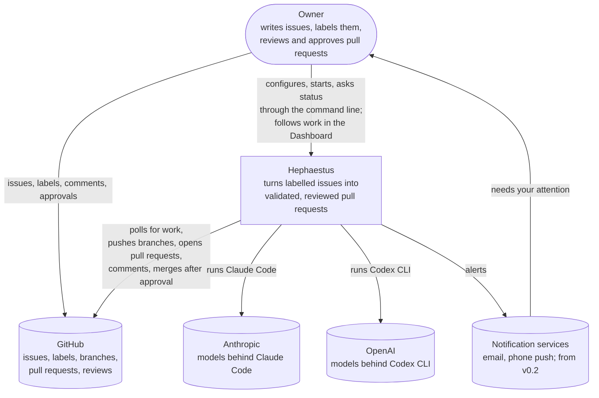
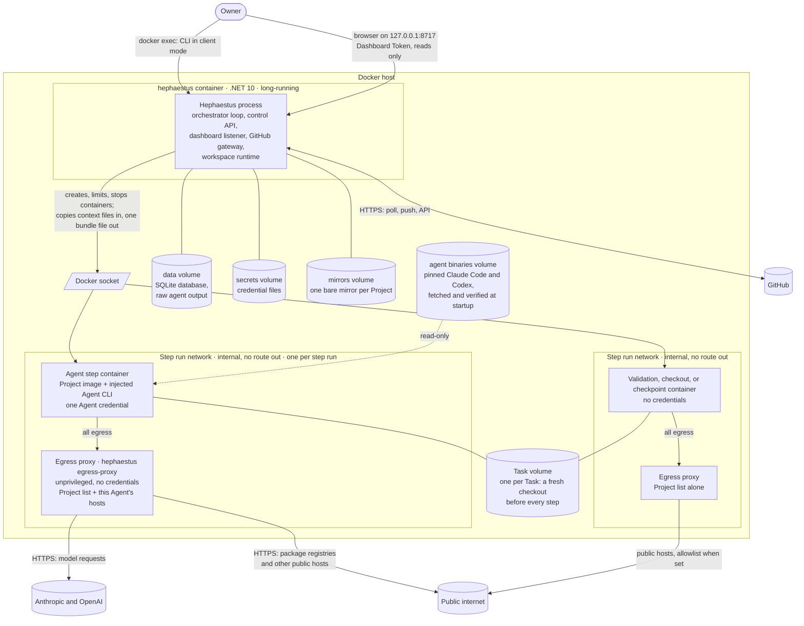
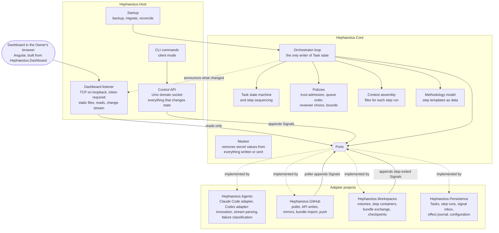
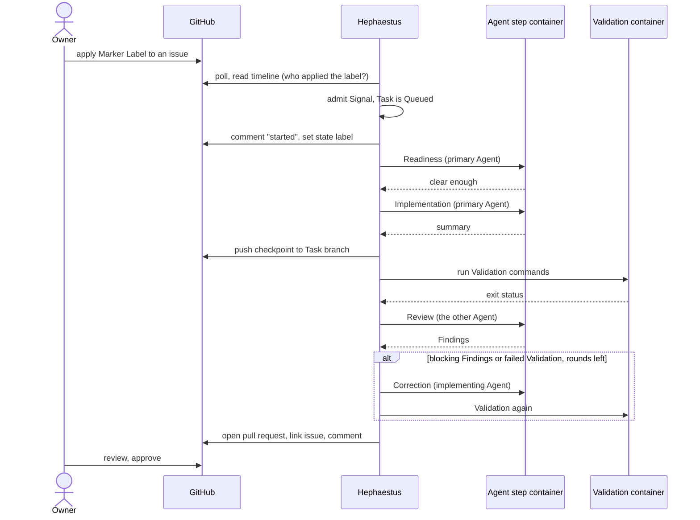

# Hephaestus in C4 Views

Three views of the same system at increasing zoom, following the [C4 model](https://c4model.com): who uses it and what it talks to, what runs where, and what is inside the one process that matters. The diagrams describe the design for releases v0.1 to v0.3; nothing here is implemented yet. The reasoning behind the shapes is in [architecture.md](architecture.md) and the [decision records](adr/).

## Level 1: System context

Hephaestus sits between the Owner's GitHub repositories and the coding agents the Owner already pays for. The Owner never talks to an agent directly; they write issues and review pull requests.

## Level 2: Containers

Everything runs on one Docker host. Apart from `hephaestus`, every container lives for a single step of a single Task; the egress proxy is one of them, one per step run ([ADR-0021](adr/0021-egress-proxy.md)).

| Container | Lifetime | Holds credentials | Notes |
| --- | --- | --- | --- |
| `hephaestus` | Long-running | GitHub App key, all Agent credentials (from the secrets volume) | The only container with the Docker socket. Root-equivalent on the host. Serves the Dashboard on a port published on the host's loopback address only; it is on no network a step container or the egress proxy is on. |
| Agent step container | One step | The credential of the one Agent running that step | Runs as a non-root user with all capabilities dropped. The agent's own sandbox is off; the container is the boundary. |
| Validation container | One command | None | Runs one of the Project's build or test commands on a fresh checkout, in the Project image. |
| Checkout and checkpoint containers | Seconds | None | Run a small tools image with git only: re-create the checkout before a step, and afterwards write one commit and one bundle file. |
| Egress proxy | One per step run, for the step's duration | None | `hephaestus egress-proxy`, a command of the `hephaestus` image, on the step run's internal network and on `hephaestus-outbound`. The only exit from the step run's network. Refuses loopback, link-local, and private destinations and applies each step's allowed hosts: the Project's list, plus an Agent's own hosts in that Agent's container only. Unprivileged, with no volume and no Docker socket. |

No volume is shared between Tasks, and a Task volume is never mounted into the `hephaestus` container. Work crosses that line only as a git bundle.

## Level 3: Components of the Hephaestus process

The process is a modular monolith. The core defines ports; adapters implement them. An adapter never calls another adapter.

| Component | Responsibility | Never does |
| --- | --- | --- |
| Orchestrator loop | Applies Signals in order, one transaction each; advances Tasks; records intents and results around every outside effect. | Hold state only in memory, or wait for a running step. |
| Policies | Decide who is trusted, what runs next, who reviews, when to stop. | Talk to GitHub or Docker. |
| Agent adapters | Describe how to invoke a CLI for a step and interpret what it prints. | Start a process or call Docker. |
| GitHub gateway | The single path to GitHub: reads events, writes effects, owns mirrors, pushes. | Decide trust or change Task state. |
| Workspace runtime | Runs what it is given in a container with limits; moves bundles and context files across the boundary. | Know which Agent it is running. |
| Persistence | Stores what the core asks it to. | Contain rules. |
| Dashboard listener | Serves the Dashboard and answers reads through a read-only store; forwards the loop's announcements as Server-Sent Events. | Append a Signal, change configuration, touch a secret, or accept anything from the browser but a read. |

## A Task from label to pull request

A dynamic view of the default path, for readers who prefer to follow one request through. Before each step a fresh checkout of the last pushed commit is made; that is left out of the diagram.

