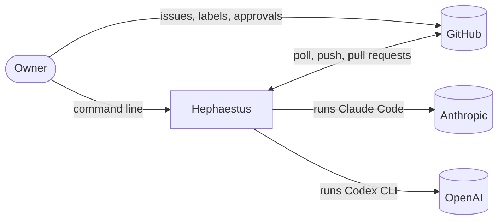
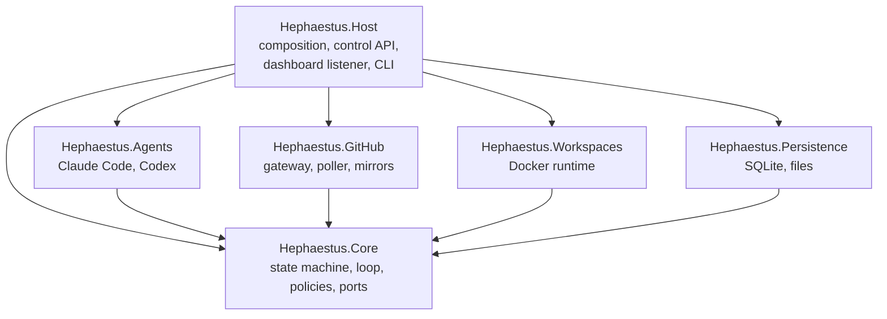
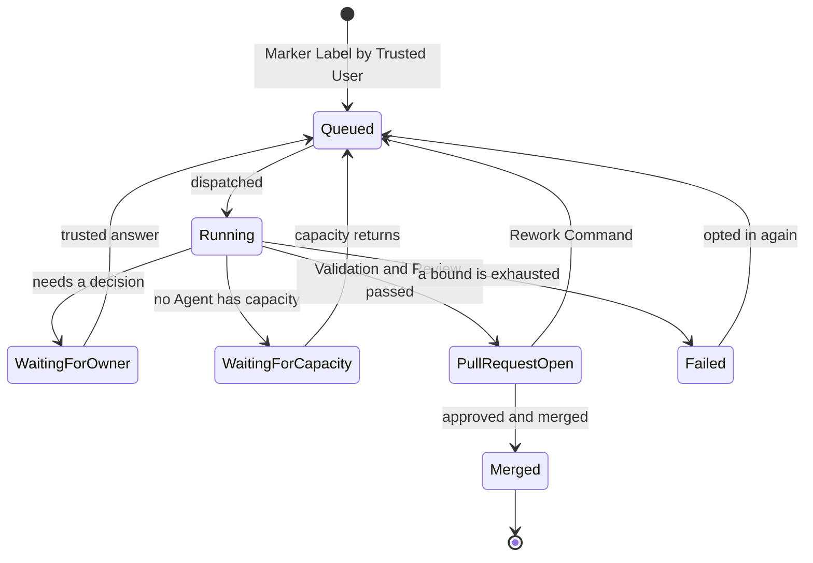
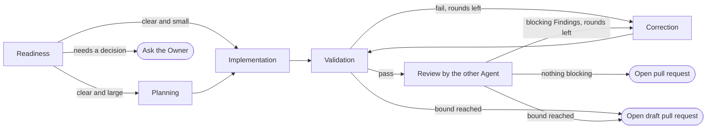
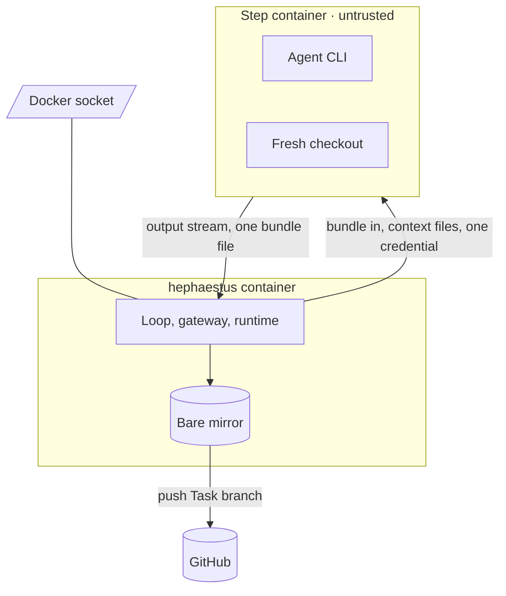
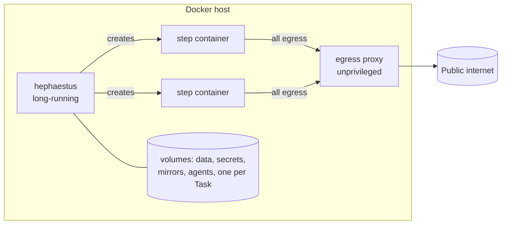

# Hephaestus Architecture

**Status:** design, approved by the project owner on 2026-11-25 for releases v0.1 to v0.3. No application code exists yet. Where a decision still depends on a technical spike, this document says so.

This document explains how Hephaestus is put together and why. It is written for contributors and for anyone evaluating the project. Three companions go deeper:

- [Decision records](adr/) give the alternatives weighed for each decision.
- The [threat model](security/threat-model.md) states what the design is meant to withstand and what it is not.
- [C4 views](architecture-c4.md) show the system at three levels of zoom.

Terms such as Task, Workspace, Finding, and Escalation are used as the product requirements define them.

## 1. What Hephaestus is

Hephaestus turns a GitHub issue into a reviewed pull request by driving coding agents the user already has. A developer writes an issue and labels it. Hephaestus prepares an isolated environment, has one agent implement the change, runs the project's own build and tests, has a second agent from a different vendor review the result, lets the first agent correct what the review found, and opens a pull request. Nothing is merged without the developer's explicit approval.

It is not a coding agent. It is the layer above agents that decides what runs, when, with which agent, in which environment, and what has to be true before work counts as done.

## 2. The forces that shaped the design

Four requirements do most of the shaping.

1. **Unattended operation.** Work is queued in the evening and reviewed in the morning. The system must survive restarts, outages, and agents running out of usage without a person nudging it, and must never repeat an outside effect such as opening a second pull request.
2. **Agents are not trusted.** An agent executes commands and reads text written to manipulate it. Containment cannot depend on the agent behaving.
3. **Agents are interchangeable.** A Task may start with one vendor's agent and finish with another's. Nothing about how a step is done may depend on which agent does it.
4. **One person runs it on one machine.** No server fleet, no message broker, no paid dependency.

## 3. Shape: a modular monolith with a single writer

Hephaestus is one process with a core and a ring of adapters, the pattern often called hexagonal or ports and adapters. The core owns the Task state machine and the orchestrator loop and defines interfaces, called ports, for everything outside itself. Adapters implement those ports.

The arrows are project references, and they are the whole rule: the core references no adapter, adapters reference only the core, and two adapters cooperate only through the core. The compiler enforces this. A coding agent implementing a feature cannot reach from the GitHub module into Docker by accident. The Dashboard is a seventh directory under `src/` but not a seventh project in this sense: it is an Angular application that no .NET project references, and its only contract with the rest is the read API. Six projects were chosen because there are six boundaries; the brief's warning against fragmentation was weighed and this is the minimum that makes the boundaries real ([ADR-0001](adr/0001-modular-monolith-with-hexagonal-boundaries.md)).

### The orchestrator loop

One loop is the only writer of Task state. Everything else that wants something to change appends a **Signal** to a persisted inbox: the GitHub poller when a label is applied, the control API when the Owner cancels a Task, the Docker runtime when a container exits. The loop takes Signals in order and applies each in a single database transaction that also records the effects it intends to cause.

This is the idea at the centre of OpenAI's Symphony specification, with one difference. Symphony keeps its state in memory and rebuilds it from the tracker after a restart. Hephaestus must not duplicate a pull request and must keep a full history, so its state is durable ([ADR-0002](adr/0002-single-writer-orchestrator-and-fixed-lifecycle.md)).

Two alternatives were rejected. A durable-execution engine would supply timers and retries, at the cost of a heavy dependency and replay rules that constrain every line of workflow code; the product has one fixed lifecycle and does not need a general engine. Full event sourcing would give history for free, with more ceremony than a single writer handling one Task at a time can justify.

The loop never waits for a step to finish. It starts a container and returns to its inbox; the container's exit arrives later as a Signal. A cancellation, a new label, or an answer to a question is therefore applied within one tick even while an agent is in the middle of an hour-long run.

### Where the truth lives

Task state exists in two places: Hephaestus's database and GitHub. They can disagree, because a person can change a label or close a pull request by hand at any time. The rule is to split authority by who owns the fact ([ADR-0003](adr/0003-source-of-truth-split-between-github-and-sqlite.md)).

- **GitHub owns human intent.** Was the issue opted in, by whom, was the pull request approved, was a question answered. Hephaestus reads intent only from events that name who acted, never from the current set of labels, so a user who is not trusted cannot stop or restart work by toggling a label.
- **The database owns execution state.** Which step is running, how many attempts were made, what was done. The state labels and progress comments Hephaestus writes are a projection of the database; if someone edits them, the loop writes them back.

## 4. The life of a Task

The diagram shows the main path; cancellation, withdrawal, and closing are in the [spine](../_bmad-output/planning-artifacts/architecture/architecture-Hephaestus-2026-11-25/ARCHITECTURE-SPINE.md). Two properties matter. `Running` is entered only from `Queued`, so the rule that one Task runs at a time is enforced in one place. And every waiting state records what it is waiting for, so nothing depends on a timer held in memory.

An issue can declare that it depends on another with a line `Depends-On: #<number>`. A Task with an unsatisfied dependency stays `Queued` and is passed over. Until stacked pull requests arrive in v0.3, a dependency is satisfied only when the Task it names has been merged: a dependent Task branches from the Base Branch, so the code it builds on has to be there. Before v0.3 the Owner merges on GitHub and Hephaestus learns of it from the next poll.

Only a merge by a Trusted User counts. If anyone else merges the pull request, the Task is cancelled and the reason is reported on the issue. Hephaestus does not undo the merge; it never writes to the Base Branch except to merge an approved pull request. A Trusted User can accept the merge afterwards with `/hephaestus confirm` on the pull request, and the Task then counts as merged.

While a Task is `Running` it moves through steps:

Any agent step may answer "I need a decision" in place of a result. That becomes a question on the issue, the Task waits, and the loop takes the next Task.

**Validation decides, not the agent.** A step's result is a structured document checked against a schema the core owns; a missing or malformed result is a failure, never something to interpret. Whether the work is acceptable comes from two things only: the exit status of the project's own build and test commands, run in a container with no credentials on a fresh checkout, and the Reviewer's Findings.

**Failures have one vocabulary.** Every failed step is exactly one of: usage limit, timeout, agent error, validation failure, infrastructure error, cancelled, unknown. Anything not positively identified is unknown, and unknown is never treated as a usage limit, because the signals vendors emit at a limit are undocumented. Two separate bounds apply: failed Validation and blocking Findings spend correction rounds, while timeouts and errors spend a retry budget for that step.

## 5. Agents

Both supported agents are driven through their official non-interactive command lines: `claude -p` and `codex exec`. The vendor SDK ships for Python and TypeScript only, and the Agent Client Protocol reaches both tools only through third-party adapters, so the command line is the common ground ([ADR-0004](adr/0004-agents-as-cli-processes-behind-pure-adapters.md)).

An agent adapter is deliberately small. It describes how to invoke the CLI for a step, and it interprets what the CLI printed. It starts no process and knows nothing about Docker. The Docker runtime, in turn, runs what it is handed and knows nothing about agents. This keeps vendor quirks in one place and makes an adapter testable against recorded transcripts with no container and no vendor call.

### Every step starts cold

A step is given a directory of files (the issue as the Owner vouched for it, the plan, earlier Findings, Validation results) and the repository at its current commit. It runs in a fresh agent session. Session resume is not used ([ADR-0005](adr/0005-artifact-sufficient-steps-without-session-resume.md)).

This costs tokens: in a correction round the agent re-reads context it has seen before. It buys something worth more. Handing a Task from one vendor's agent to another's is the feature the product exists for, and it cannot rely on conversation history. If normal steps resumed sessions, handoff would be a second code path exercised only when a limit is hit. With every step starting cold, a handoff is an ordinary step given to a different agent, and the path is tested by every Task.

### One methodology for every agent

How a step is to be performed is data: a directory with one instruction template per step kind. A built-in default and BMAD Method ship with Hephaestus. The core picks a template by step kind and never branches on which methodology or which agent is in use, so the implementer and the Reviewer are held to the same standard ([ADR-0012](adr/0012-methodology-as-data.md)).

### Capacity

Running out of usage is a fact about an agent credential, not a failure of the Task that happened to meet it. Hephaestus records it per credential and consults it before dispatching, so the next Task is not sent to an agent already known to be exhausted. A Task waiting for capacity does not hold up other work.

## 6. GitHub

One module, the gateway, is the only code that talks to GitHub and the only holder of Hephaestus's GitHub credential ([ADR-0006](adr/0006-github-behind-a-single-gateway.md)). Hephaestus acts as a GitHub App with its own identity. That is required, not cosmetic: GitHub does not let the author of a pull request approve it, so pull requests opened with the Owner's own token could never be approved by the Owner.

The gateway polls. No public webhook endpoint is needed, which keeps a default installation behind a home router working. Conditional requests keep polling cheap.

### Doing things once

A crash between "opened the pull request" and "recorded that it was opened" must not produce a second pull request. Before any outside effect, the loop records an **intent** with a deterministic key; afterwards, the result. On startup, an intent with no result is resolved by looking for the effect on GitHub by a natural key: a pull request by its branch, a comment by a hidden marker in its last line. The same journal is the audit trail ([ADR-0007](adr/0007-effect-journal.md)).

## 7. Workspaces

This is the part of the design that security shapes most.

**A container per step.** Each step runs in a fresh container that is removed when the step ends. The container holding one vendor's agent holds only that vendor's credential. Containers that run Validation, check out code, or commit hold none ([ADR-0008](adr/0008-workspace-shape-and-container-boundary.md)).

**The container is the boundary.** Agents run with their own sandboxes and permission prompts switched off, because those are not what contains them. The container is: a fixed non-root user, every capability dropped, no host mounts, no Docker socket, no route to the host or the local network. Only the orchestrator holds the Docker socket, which makes the orchestrator equivalent to root on the host. The threat model says so plainly.

**One way out of the network.** Step containers sit on an internal Docker network that has no route out. Its only exit is an egress proxy: a separate, unprivileged container that holds no credential and no socket. The proxy resolves names itself, refuses anything that resolves to a loopback, link-local, or private address, and applies the Project's list of allowed hosts when one is set. One mechanism therefore enforces both the rule about what a step may reach and the per-Project allowlist. The proxy is deliberately not part of the orchestrator process, because that process holds the Docker socket and should not handle untrusted traffic.

Allowed hosts are set for each step, not for the whole Task. The hosts an agent's CLI needs are declared by its adapter and allowed only in the container that runs that agent; a container that runs Validation gets the Project's list alone. A Project therefore never lists vendor hosts, and build and test code cannot reach a vendor's API unless the Project allows it.

A tool that cannot use an HTTP proxy has no network access from a step container. That is the other side of the same control, and three things keep it from getting in the way. Hephaestus sets the proxy variables in every step container, with the container's own loopback excluded, so a test database on `localhost` still works. It configures git to fetch `github.com` over HTTPS where a dependency names an SSH address; SSH would fail anyway, because a step container holds no key. And a host the proxy refused is recorded with the step, so a failed build names the host instead of ending in a bare network error. Settings specific to one ecosystem, such as proxy options for the JVM, belong in the Project's image.

**Only the committed tree survives a step.** Before every step the checkout is re-created from the last pushed commit. Without this, an agent could leave behind a git hook or a doctored test runner among ignored files, and the next step would execute it beside the other vendor's credential, or Validation would report a pass that was forged. The price is that dependencies are restored on every step ([ADR-0009](adr/0009-only-the-committed-tree-survives-a-step.md)).

**Code crosses the line as a git bundle.** The step container has no GitHub credential, so the orchestrator pushes. The obvious way, running `git push` in the agent's working copy, would execute whatever the agent planted in `.git/config` inside the one process that holds the GitHub credential and the Docker socket. So the orchestrator never runs anything in a directory an agent could write to. A credential-free container writes one commit and packs it into a bundle file. The gateway imports that file into a bare mirror with strict checking, confirms it only moves the Task's own branch forward, scans it for secret values, and pushes ([ADR-0010](adr/0010-bundle-boundary-and-checkpoints.md)).

A checkpoint is taken after every step that changes code, including one cut short by a timeout or a crash, so the branch on GitHub always holds the work done so far.

**Agent programs are supplied by Hephaestus.** A Project names any Linux image with its toolchain, for example the stock .NET SDK image. Hephaestus mounts the agent CLIs into it read-only. Each Hephaestus release pins one version of each CLI, because their output formats change often and an adapter is only trustworthy against the version it was tested with. The binaries are downloaded from the vendors and verified at startup; they are not redistributed in Hephaestus's images ([ADR-0011](adr/0011-agent-clis-pinned-and-injected.md)). This depends on a spike that has not been run yet.

## 8. Configuration and secrets

Configuration is split along a trust line ([ADR-0013](adr/0013-configuration-secrets-and-trust.md)).

| Lives in the repository (`hephaestus.yml`) | Lives in the installation |
| --- | --- |
| Default agents and effort, methodology, validation commands, stacking mode, correction bound, image | Registered Projects and their Base Branch, schedules, Trusted Users, aliases, limits, protected paths, credentials, notification channels |
| Versioned and reviewed with the code | Out of reach of anything an agent or an outside contributor can change |

The repository file is read only from the Base Branch and copied onto the Task when it starts. A Task cannot change the rules of its own run, and a change takes effect only after the Owner merges it.

Secret values are files on a volume mounted only into the orchestrator. The database stores their names. One masker, built from every secret value, filters agent output before it is stored, every message sent to GitHub, every log line, and every commit before it is pushed.

Trust in people is decided in one place. The gateway attaches the acting user's numeric id to each event; one function in the core decides whether that user is trusted; anything else is recorded and ignored.

The same care applies to text. An agent is given the issue as it stood when a Trusted User applied the label, and comments written by Trusted Users. Hephaestus keeps a hash of each admitted text and compares it on later reads, so an edit is noticed even when no event announced it. It then asks GitHub's edit history who made the edit. If that was not a Trusted User, or cannot be established, the Task is held until a Trusted User confirms the new text with `/hephaestus confirm`.

## 9. Persistence

SQLite, in one file on a Docker volume, through Entity Framework Core ([ADR-0014](adr/0014-local-persistence.md)). With one Task running at a time and one writer, its single-writer model costs nothing, and it needs no server to run, back up, or upgrade. Raw agent output is large and rarely read, so it is kept as files beside the database with an index and a retention period. Structured history is kept indefinitely.

On upgrade, the database is backed up, migrations run, and a failed migration stops startup with the backup intact.

## 10. Deployment

One Compose file, the long-running `hephaestus` service, the egress proxy, and short-lived containers that `hephaestus` creates. The command line is the same executable in client mode, run with `docker exec`; it talks to the control API on a Unix socket inside the container and does nothing else. That socket is on no network, and it is the only place anything can be changed ([ADR-0015](adr/0015-one-host-process-and-cli-as-api-client.md)).

### The Dashboard

From v0.1 the Owner can also follow Hephaestus in a browser. The Dashboard is an Angular application that the `hephaestus` process serves as static files on a second listener, and it grows with each release: Projects, configuration, Tasks, and Task history first; Schedules, Agent capacity, status, and statistics in v0.2; pull requests awaiting approval and Stacks in v0.3.

The process that serves it holds the Docker socket, so the listener is built to be as dull as possible:

- **It can only read.** No endpoint that changes anything is mapped on it, and a test fails if one ever is. Starting work, changing configuration, entering a secret, and issuing a token all stay on the control API. A stolen token therefore reads history; it cannot start, stop, or merge anything.
- **It is local.** The port is published on the host's loopback address only. The `hephaestus` container shares no Docker network with a step container or with the egress proxy, so a Workspace cannot reach it.
- **It needs a token.** The Owner issues a Dashboard Token from the command line. It travels in a request header, never in a cookie or an address, so a web page open in the same browser has nothing to ride on. Hephaestus stores only its hash.
- **It shows text as text.** Issue bodies, Findings, and Agent output are never interpreted as markup, and the page loads nothing from any other origin.

The Dashboard stays current through one stream of Server-Sent Events. After each committed change the loop announces which Task or Project changed, as an id and nothing more, and the Dashboard reads the new state through the same read endpoints as before. A missed announcement costs nothing, because the Dashboard reads everything again whenever the stream reconnects. The stream carries no Agent output: a step appears when it starts and when it ends, and its output is available after it ends. SignalR was considered and set aside: its browser transport carries the token in the address, and its channel is two-way, which a read-only listener should not need exceptions for.

Images are published for amd64 and arm64. Only Linux containers are supported.

### Language

Hephaestus speaks English by default and Polish when the Owner chooses it. One rule keeps this cheap and safe: **what a person reads is translated; what a program reads never is.** Every sentence is a message id with parameters, resolved in the core from resource files for both languages, and a build that lacks a translation fails. Command names, `--json` output, labels, state names, comment commands, configuration keys, and log lines are the same in every language, as are the Glossary's terms.

The installation has a language; a Project may name its own for the text written on its issues and pull requests; the Dashboard can be switched in the browser. Text an Agent writes follows the Task's language without a second set of instruction templates: the language travels in `task.json`, and the template tells the Agent to write prose in the language named there ([ADR-0019](adr/0019-language-is-data.md)).

### How Hephaestus's own code is built and released

Two protected branches, `develop` and `main`; every change arrives by pull request. A pull request must pass the build, the tests, a coverage threshold of 80% over all code enforced by the build itself, the license check, and SonarQube Cloud's quality gate, which requires 80% coverage on new code. A merge to `develop` publishes a `develop` preview image. A merge to `main` publishes the version the repository states, and the pull request to `main` cannot merge unless that version is valid, new, and in the changelog.

SonarQube Cloud is a hosted service used to check this repository; nobody needs it to run Hephaestus. The workflow stores no SonarQube token: it exchanges a GitHub-issued identity for a credential that lasts thirty minutes and can only submit an analysis for this project. That matters because the same workflow runs code from the pull request, some of it written by an Agent ([ADR-0020](adr/0020-branches-quality-gate-and-image-channels.md)).

### How this grows

The brief describes three deployment modes. The design keeps the later two possible without building them.

| Mode | What changes |
| --- | --- |
| **Personal** (v1) | As described here. |
| **Server** | The Dashboard becomes reachable from other machines: encryption in transit, sign-in, more than one user. If it gains actions, each is a Signal like any other. |
| **Distributed** | The Workspace runtime port is the seam between orchestration and execution. A remote implementation of it would run steps on other machines; the loop, which already treats a step as "start, then wait for a Signal", would not change. |

## 11. Technology

| Area | Choice | Note |
| --- | --- | --- |
| Runtime | .NET 10 (LTS), C# 14 | .NET 11 was released two weeks before this was written and ends support on the same day; nothing is gained by the newer one yet ([ADR-0016](adr/0016-runtime-and-libraries.md)). |
| Storage | EF Core 10 with SQLite | |
| GitHub | Octokit 14 | |
| Docker | Docker.DotNet.Enhanced 4.4 | The original Docker.DotNet has had no release since 2023. |
| CLI | System.CommandLine 2.0 | |
| Configuration | YamlDotNet 18 | |
| Tests | xUnit v3, NSubstitute, Testcontainers | Adapters are tested against recorded CLI transcripts. |
| Quality gate | SonarQube Cloud, coverage thresholds in the build | Used to build this repository, not to run Hephaestus. |
| Dashboard | Angular 22, TypeScript 6.0, Vitest | Built with Node.js 26 LTS in a build stage; the runtime image contains the built files and no Node.js. Live updates use Server-Sent Events, which need no package. |
| Logging | Built-in structured logging, JSON to stdout | OpenTelemetry is deferred. |

Deliberately absent: a message broker, a second database, a workflow engine, .NET Aspire, Kubernetes, a second web server, anything loaded from a content delivery network, SignalR or any other two-way channel to the browser.

## 12. What is not decided

- **Spikes that gate v0.1.** Whether both CLIs, and the common package managers, run under the hardened container definition and through an HTTP proxy, and which BMAD workflows complete unattended.
- **Codex with a subscription sign-in.** It needs a credential file refreshed between runs, which conflicts with the rule that nothing from a step container is written back to the secrets store. Until that is solved, Codex is supported with an API key.
- **The egress proxy in detail.** The mechanism is fixed; which proxy is used, how it is started and given each step's allowed hosts, and how step containers are kept from reaching each other on a network they share with it are to be settled with the v0.1 execution work. Traffic that is not HTTP or HTTPS, and intercepting traffic without the client's cooperation, are out of scope for v1.
- **Reading who edited a text.** GitHub's GraphQL API lists the edits of an issue body or comment with their editors. Whether it does so for a GitHub App's token is to be confirmed by a test. Until then, and wherever the editor cannot be read, the Task is held.
- **Dependencies that can never be satisfied.** A Task whose dependency failed, was closed without a merge, or is not a Task at all is never started. What the Owner is told about it is to be settled with the intake work.
- **Later releases.** Usage-limit detection and notifications (v0.2); stacked pull requests, merge, and rework (v0.3).
