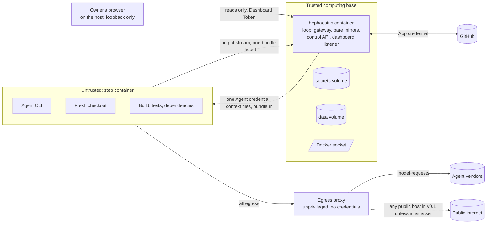

# Hephaestus Threat Model

**Status:** design stage. Nothing described here has been implemented or tested, except what the [injection spike](../spikes/injection/README.md) recorded on 2026-11-25 for the pinned CLI versions. This document states what the design is meant to withstand, what it does not attempt, and what must be demonstrated before any security claim is made. Hephaestus must not be described as secure beyond what the verification plan in section 8 has shown.

**Applies to:** releases v0.1 to v0.3 as designed in the [architecture](../architecture.md). Identifiers such as AD-7 refer to decisions in the architecture spine; the [decision records](../adr/) give the reasoning.

## 1. What is being protected

Hephaestus takes a GitHub issue, runs a coding agent on it inside a container, and pushes the result as a pull request. Two things make this dangerous. A coding agent executes arbitrary commands, and it reads text that may have been written to manipulate it. The design therefore assumes that **anything inside a step container may be hostile**: the agent, the repository's code, and every dependency the build pulls in.

| Asset | Why it matters |
| --- | --- |
| The Docker host and the Owner's files | The host is typically the Owner's own machine. |
| The GitHub App credential | Can push branches, open and merge pull requests, and comment on every registered Project. |
| Agent credentials (API keys, subscription tokens) | Cost money when abused; a subscription token is tied to the Owner's personal account and whatever is linked to it. |
| The Base Branch of each Project | Everything merged there is trusted by later Tasks, including Project Configuration and Methodology files. |
| Other Projects' and other Tasks' source code | A Task must not read or alter work that is not its own. |
| Repository secrets used by CI | Reachable by code that runs in GitHub Actions on a pushed branch. |
| Execution history | The audit trail the Owner relies on to understand what happened. Readable through the Dashboard by whoever holds a Dashboard Token. |

## 2. Actors

| Actor | Trust |
| --- | --- |
| Owner | Fully trusted. Operates the host and the installation. |
| Trusted User | A GitHub account the Owner has listed, identified by numeric id. Their labels, approvals, answers, and commands are acted on. |
| Other GitHub users | Untrusted. On a public repository anyone can open issues, comment, and open pull requests; collaborators who are not Trusted Users can also label and edit. |
| Coding agent | Untrusted once running. It follows instructions found in text, and it can be wrong. |
| Repository content | Untrusted as executable material, even when merged: build scripts, tests, and agent configuration files all run or are read inside the step container. |
| Third-party packages | Untrusted. Installed and executed during build and test. |
| Agent vendors and GitHub | Trusted to behave as documented. Their availability is not assumed. |
| The Owner's browser | Trusted to run the Dashboard. Other pages open in it, and other processes on the host, are untrusted. |

## 3. Trust boundaries

There are six boundaries.

1. **Step container to orchestrator.** Two things cross outward: the agent's output stream and one git bundle file. Both are treated as data. The stream is masked, stored, and parsed. The bundle is imported into a quarantine ref with strict object checking. The orchestrator never runs a tool inside a directory the agent could write to and never mounts a Task volume (AD-7, AD-9).
2. **Step container to host and network.** Enforced by the container runtime with a fixed, minimal container definition, and by an internal network whose only exit is the egress proxy (AD-7).
3. **Step to step.** Only the committed tree survives a step. Every step starts from a fresh checkout of the last pushed tip, so nothing a step leaves outside the commit reaches the next one (AD-6).
4. **GitHub to orchestrator.** Inbound events are acted on only when GitHub's own event data names a Trusted User, by numeric id, as the actor (AD-15).
5. **Repository to rules.** Project Configuration and Methodology files are read only from the Base Branch, so a change takes effect only after the Owner has merged it (AD-14, AD-16).
6. **Browser to orchestrator.** The dashboard listener is the one place the orchestrator answers a network request. It is published on the host's loopback address only, requires a Dashboard Token in a request header, and maps no endpoint that changes anything: everything that changes state stays on the control listener, a Unix domain socket inside the container (AD-17).

The orchestrator holds the Docker socket and is therefore equivalent to root on the host. It is the trusted computing base. A flaw in the orchestrator is a flaw in the host, and that includes a flaw in the dashboard listener.

## 4. Threats and mitigations

Residual risk is rated for v0.1 as designed: **low**, **medium**, or **high**.

### 4.1 Manipulating the agent

| # | Threat | Mitigation | Residual |
| --- | --- | --- | --- |
| T1 | **Prompt injection through an issue or comment** written or edited by an untrusted user. | The title and body are admitted as vouched for by the Marker Label event; a comment only when its author and every later editor are Trusted Users. A later edit by anyone else holds the Task until a Trusted User confirms (AD-15, NFR-1). An edit is detected by comparing a hash of the text with the hash recorded at admission, so it is noticed even when no event announced it; an edit whose editor cannot be read from GitHub's edit history is treated as untrusted. Hephaestus's own comments, which carry agent-derived text, are never admitted. | Low. A Trusted User can still vouch for hostile text without reading it. Where GitHub does not expose the editor (Open Question 2), the cost is an extra confirmation, not exposure. |
| T2 | **Prompt injection through repository content**: a file, code comment, or dependency README instructs the agent. | Not prevented. Contained instead: the agent can only affect its own checkout and its own vendor credential, cannot act on GitHub, and its work reaches the Base Branch only through Validation, an independent Review, and the Owner's approval. Neither Agent is given the repository's own instruction file (`CLAUDE.md`, `AGENTS.md`): each adapter switches its CLI's reading of it off (AD-12). | Medium. Codex CLI offers a repository's skills to the model whatever is switched off; whether the model acts on one depends on the model. |
| T3 | **Subverting the Reviewer** with text in the diff, or by rewriting the review workflow it follows. | The Reviewer is a different Agent from a different vendor (AD-13). Methodology files are read from the Base Branch, not from the Task's checkout (AD-14). Validation is deterministic and does not depend on any Agent. The Owner's approval is always required. | Medium. Review is a quality measure, not a security control. |
| T4 | **An Agent claims success falsely, or forges Validation** by planting a fake test runner among ignored files. | An Agent's claim never decides an outcome. Validation commands run in a credential-free container on a fresh checkout, so ignored and untracked files from an earlier step do not exist there (AD-6, AD-13). | Low. Tracked files that weaken the tests are visible in the diff and are a matter for Review. |
| T5 | **Acting through the vendor account** instead of the container: a CLI signed in with a subscription may offer tools that run outside the container under the account's authority, such as linked connectors or cloud delegation. If GitHub is linked to that account, an agent could approve its own pull request as the Owner. | Every invocation disables tools that execute outside the step container and loads only configuration Hephaestus supplies. The tools offered to the Agent are a closed list fixed by the adapter. An adapter that cannot show this for an authentication mode, by the planted-configuration test, declares the mode unsupported (AD-7). | **Shown for the pinned versions** in Claude Code's two modes and Codex's API key mode: no planted hook, MCP server, or setting executed and no account connector was listed. **Not shown:** a repository plugin; an account known to have connectors attached; Codex's tools, which rest on the model's own report. Codex subscription sign-in is unsupported. |

### 4.2 Escaping the Workspace

| # | Threat | Mitigation | Residual |
| --- | --- | --- | --- |
| T6 | **Reading or modifying host files, another Project, or another Task.** | One named volume per Task, never a host bind mount. A step container has an exact mount list and no shared volume of any kind, including caches (AD-6, AD-7). | Low, subject to T8. |
| T7 | **Reaching the container runtime**, through the socket or a daemon exposed on the network. | The Docker socket is mounted into the orchestrator only. Step containers are attached only to an internal network with no route out; the egress proxy, their only exit, resolves names itself and refuses any destination that resolves to a loopback, link-local, or private address (AD-7). | Low. Shown by `EgressProxyEngineTests` on a real Engine: the step container is on its step run's internal network alone, a direct connection fails, and the host's address, a link-local address, and another step container are refused through the proxy; `EgressProxyServerTests` covers names that resolve to private addresses, including one public and one private answer. |
| T8 | **Container escape** through a kernel or runtime vulnerability, or privilege gain inside the container. | Fixed non-root user, all capabilities dropped, `no-new-privileges`, default seccomp profile, process-count limit. Hephaestus uses standard containers, not a virtual machine boundary. | Medium. Stronger isolation (gVisor, Kata, rootless Docker) is the Owner's choice of host setup. |
| T9 | **Code execution in the orchestrator through planted git configuration or hooks.** | The orchestrator never runs git in a Workspace. A credential-free container writes a bundle; the gateway imports it into a bare mirror with no hooks and no working tree, with strict object checking, into a quarantine ref (AD-9). | Low. Depends on git's handling of hostile pack data; the images require Git 2.48 or later, because earlier versions skip object checking on bundle fetches, and both images stop their build on an older git. Mirrors are made with an empty template and every git process runs with hooks off, no configuration, and a clean environment; a test fails when any code but the one git runner starts a process (`GitMirrorRulesTests`, `GitHubMirrorsTests`). |
| T10 | **A hostile archive handed back from a container**: link entries, parent paths, or unbounded size. | The runtime accepts exactly one regular file of bounded size under a name it chose, from a stopped container, and treats it as opaque, and reads the bundle's header as text without running git on it (AD-9; `CheckpointContainerTests` and `BundleHeaderTests`, with cases for a link entry, a parent path, an extra entry, another name, a file over the bound, and a header that is not one head on the Task branch with the last pushed tip as its prerequisite). | Low. What comes back is checked again with git, in quarantine, by the gateway's import (Story 3.7). |
| T11 | **Carrying executable state from one step to the next**: hooks, git configuration, or ignored files planted by one step run beside the other vendor's credential in the next. | Every step starts from a fresh checkout of the last pushed tip, made by a credential-free container of the git-only tools image that empties the volume and makes a repository from an empty template (AD-6, AD-9; `CheckoutScriptTests`, `CheckoutEngineTests`). The checkpoint builds its own git directory outside the Task volume, mounts the volume read-only, and never uses the one in the volume, so nothing in it is read or run (AD-9; `CheckpointScriptTests`, `CheckpointEngineTests`). | Low. Costs a dependency restore on every step. |
| T12 | **Reaching the Hephaestus API from a step container.** | The control listener is a Unix domain socket inside the orchestrator container and is on no network. The dashboard listener is TCP, but the orchestrator container shares no Docker network with a step container or with the egress proxy, and the proxy refuses private and loopback destinations (AD-7, AD-17). It would also need a Dashboard Token, and could only read. | Low. Shown by `EgressProxyEngineTests`: the dashboard port on the host's address is unreachable directly and refused through the proxy (`private-address`); the orchestrator is on no network a step container or a proxy is on (`ComposeFileTests`). |
| T32 | **Attacking the egress proxy**, the one component every step container can reach. | The proxy is a separate, unprivileged container with no credential, no volume, and no Docker socket, and is never part of the orchestrator process (AD-7). | Low to medium. A compromised proxy lifts the network rule and the allowlist; it gains no credential and no path to the host. The proxy is `hephaestus egress-proxy`, one per step run on a network per step run ([ADR-0021](../adr/0021-egress-proxy.md)), so a compromised proxy lifts the rules for its own step run alone; `EgressProxyEngineTests` inspects it for user, capabilities, mounts, network, and credentials. |

### 4.3 Credentials

| # | Threat | Mitigation | Residual |
| --- | --- | --- | --- |
| T13 | **Theft of the GitHub credential.** | No GitHub credential, token, or authenticated remote URL ever enters a Workspace, step container, or context file. One module holds it (AD-4). | Low. |
| T14 | **Theft of an Agent credential** by repository code, a dependency, or a manipulated agent, sent out over the network. | A step container receives only the credential of the Agent running that step; Validation, checkout, and checkpoint containers receive none (AD-6). Repository-supplied hooks, MCP servers, and settings are switched off in every invocation, and an invocation takes Agent settings only from the throwaway `HOME` (AD-7). For Claude Code that means `--setting-sources user` in addition to `--safe-mode`, because either `--bare` or `--safe-mode` alone still applies an `env` block from the repository's settings that could redirect where requests, and the credential with them, are sent. Egress is **open to any public host in v0.1 unless an allowlist is set**, so exfiltration by build code or a manipulated agent remains possible. With a list set, the egress proxy passes only the hosts on it, but a credential can still be sent to one of those hosts. The hosts an Agent's CLI needs are opened only for the container that runs that Agent, so Validation code cannot reach a vendor's API unless the Project allows it (AD-7, AD-10). | **High in v0.1.** OpenAI's own guidance is to run Codex without its sandbox only on trusted repositories; the same caution applies here. Use an API key with a spend cap at the vendor, and set an egress allowlist. |
| T15 | **Replacing a stored Agent credential** with one for an account the attacker controls, so later Tasks send their code there. | Nothing produced by a step container is ever written to the secrets volume (AD-16). Consequence: Codex subscription sign-in, which needs its refreshed credential file kept between runs, is not supported. A second reason stands beside it: that file is a full account credential, not one limited to model requests, so code in the step container could use it for anything the account allows. | Low. |
| T16 | **Credentials appearing in logs, comments, pull request text, or pushed commits.** | One masker, built from all loaded secret values and their base64 and URL-encoded forms, filters agent output before it is stored, every outbound body, and logs. Before a push the gateway scans every new blob and commit message; a match blocks the push and raises an Escalation (AD-9, AD-16). | Low for those forms. Other encodings and split values are not caught. |
| T17 | **Secrets recovered from the database, a backup, or shell history.** | Secret values are files on a separate volume; the database holds only names. Values are entered through standard input only (AD-16). | Low for the database. The secrets volume is plain files and must be protected by the host. |

### 4.4 Acting on GitHub

| # | Threat | Mitigation | Residual |
| --- | --- | --- | --- |
| T18 | **Unauthorized Task execution or interference**: an untrusted user applies or removes the Marker Label, closes an issue, or issues a command. | Intent is read only from actor-attributed events, never from the current label set or open or closed state. One admission function decides trust by numeric user id; everything else is recorded, reported, and ignored, except a merge (T33) (AD-2, AD-15). Unregistered repositories are never acted on. | Low. |
| T19 | **Forged Hephaestus markers**: a user or an agent emits a hidden marker to make recovery believe an effect already happened. | Agent-derived text has HTML comments escaped before posting. A marker counts only when written by Hephaestus's own identity and matched by a journaled intent (AD-19). | Low. |
| T20 | **Merge without approval.** | Merge requires an approving review from a Trusted User covering the latest commit, with repository checks passing; the merge call carries the approved commit id (AD-4, FR-44). The gateway has no code path that writes to a Base Branch otherwise. | Low. Branch protection on the Base Branch is recommended as an independent control; registration reports whether it is set. |
| T33 | **A collaborator who is not a Trusted User merges a Hephaestus pull request**, putting code nobody trusted approved on the Base Branch. | Hephaestus does not treat the merge as approved work: the Task is cancelled, the reason is reported on the issue, and Tasks that depend on it are not started until a Trusted User confirms the merge (AD-1, AD-2). | **Medium.** Hephaestus cannot prevent or undo the merge, and later Tasks branch from a Base Branch that contains it, including any change to Project Configuration. Branch protection is the control; registration reports whether it is set. The same collaborator can cancel a Task this way. |
| T21 | **Destructive git operations.** | The gateway cannot push, force-push, or delete any ref outside `hephaestus/*`. Task branches are fast-forward only, and only the Task branch is accepted from a bundle (AD-4, AD-9). | Low. |
| T22 | **A Task rewrites its own rules** by editing Project Configuration, a Methodology file, or a workflow on its branch. | Configuration and Methodology are read from the Base Branch and snapshotted at Task start. By default the gateway refuses to push a diff that touches `.github/**` or `hephaestus.yml` and raises an Escalation instead (AD-14, AD-16, AD-19). | Low. The Owner can lift the path protection per Project; a merged change to Validation commands then runs in every later Workspace. |
| T23 | **Abuse of CI**: a pushed Task branch triggers existing GitHub Actions workflows, which run agent-written build and test code with the repository's secrets and token. | The GitHub App is never granted the `workflows` permission and protected paths keep workflow files out of Task branches. This does not stop existing workflows from running agent-written code. | **Medium to high**, depending on the repository. Owners must ensure workflows triggered by `hephaestus/*` branches and their pull requests have no access to deployment or publishing secrets and a read-only token. Installation documentation must say so. |
| T24 | **Hostile text posted under Hephaestus's identity**: mentions, issue-closing keywords, or command keywords in agent output. | Pull request descriptions and comments are composed by Hephaestus from validated results; agent-derived text is neutralised first: mentions and closing keywords broken, command keywords fenced (AD-19). | Low. Misleading prose remains possible. |

| T39 | **The analysis credential used by code from a pull request to Hephaestus's own repository**, including code an Agent wrote, because pull request analysis runs in the workflow that builds and tests that code. | No long-lived token exists: the workflow exchanges a GitHub-issued OpenID Connect token for a credential that lasts thirty minutes and can only submit an analysis for this one project. Workflow files are a protected path, so a Task cannot change them (AD-19). The repository's OpenID Connect identity is trusted by nothing else. Pull requests from forks cannot obtain it. | Low, accepted. Code in the same job could submit a forged analysis of a public project within those thirty minutes. |

### 4.5 Resources and availability

| # | Threat | Mitigation | Residual |
| --- | --- | --- | --- |
| T25 | **Runaway cost or compute.** | Every Agent run and Validation command has a recorded deadline enforced by the runtime; processor, memory, and process-count limits are set on the container. Correction rounds, step retries, and Handoffs each have a bound. One Task runs at a time. | Low for compute. A spend limit applies only where the Agent reports usage; in subscription mode it cannot be enforced, and Hephaestus says so (NFR-5). |
| T26 | **Disk exhaustion** through large output or Workspaces. | Raw output has a retention period. Task volumes are removed once their work is pushed. | Medium. No size limit on a Task volume in v0.1. |
| T27 | **Loss or duplication after a crash.** | Durable state, one transaction per Signal, the effect journal, and a checkpoint push after every step that changes code (AD-1, AD-5, AD-9). | Low. To be verified by fault-injection tests. |
| T28 | **An outage turned into failures**: GitHub or a vendor is unreachable. | Unreachable effects are retried at a recorded time within a bound while the Task keeps its state; at the bound the Task waits for the Owner (AD-5). An unavailable Agent has no capacity; it is not a failed step (AD-20). | Low. |

### 4.6 Supply chain

| # | Threat | Mitigation | Residual |
| --- | --- | --- | --- |
| T29 | **A tampered Agent CLI binary.** | Each release pins a version and a checksum per executable, architecture, and C library. The orchestrator downloads from the vendor's official channel at startup and verifies every executable before use; startup stops if one is missing or does not match. The vendor's signature is verified when a pin changes. Self-update is disabled in step containers (AD-8). | Low. |
| T30 | **A hostile or silently changed Project image.** | The image is named in Project Configuration on the Base Branch. The digest resolved at Task start is recorded and used for every step of that Task (AD-8). It runs with the same restrictions as any step container. | Low. |
| T31 | **Malicious dependencies installed during build.** | Not prevented. Contained by the step container; limited by T14's controls. | Medium, high while egress is open. |

### 4.7 The Dashboard

The Dashboard is read-only and local in v0.1 to v0.3. These threats exist because the orchestrator now answers HTTP requests.

| # | Threat | Mitigation | Residual |
| --- | --- | --- | --- |
| T34 | **Another process or user on the host reads the Dashboard** through the loopback port. | Every read and the change stream require a Dashboard Token. Tokens are stored only as a hash, shown once when issued, never logged, and revocable from the command line; revoking one closes the streams opened with it (AD-17). | Low to medium. Loopback is shared by everything on the host; the token is the only barrier. |
| T35 | **A web page the Owner visits attacks the Dashboard**: a cross-site request, or a host name rebound to the loopback address. | The listener maps reads only, uses no cookie, so a browser attaches no credential on its own, and refuses host names other than its own loopback names (AD-17). | Low. |
| T36 | **Script injected through content the Dashboard shows**: an issue title or body, a comment, a Finding, a plan, or Agent output. | Such text is rendered as text, never as markup; a lint rule forbids bypassing the framework's escaping. The content security policy allows no other origin and no inline script, and the Dashboard loads nothing from another origin (AD-17). | Low. Depends on every view obeying the rule; the lint rule and the policy are two independent checks. |
| T37 | **A stolen Dashboard Token.** | The holder can read and cannot change anything, because no changing endpoint is mapped on that listener. No secret value is shown, and Agent output is shown as stored, that is, masked (AD-16). The token never appears in an address and is revocable. | Medium for confidentiality: the holder reads Task history, issue text, and masked Agent output. |
| T38 | **Exhausting the orchestrator with open change streams.** | A stream needs a valid token, the number of open streams is bounded, a stream that falls behind is closed, and an event carries a scope and an id only (AD-17). | Low. |

## 5. Authentication mode

How an Agent signs in changes the exposure.

- **API key.** The credential can be capped at the vendor and revoked without touching the Owner's personal account. This is the conservative choice.
- **Subscription sign-in.** The credential belongs to the Owner's personal account. Two things follow. First, whatever is linked to that account may be reachable by the CLI unless it is switched off (T5). Second, the vendor's terms describe subscription sign-in as intended for ordinary individual use and allow enforcement without notice; this is a policy risk, not a security one, and installation documentation must state it (FR-25).

Hephaestus implements no sign-in flow of its own. The Owner signs in with the vendor's tool and supplies the resulting credential.

Claude Code supports both modes, the subscription mode with a token from `claude setup-token`, which the vendor documents as limited to model requests. Codex is supported with an API key only (T5, T15).

## 6. Assumptions

- The Docker host is controlled by the Owner and is not shared with untrusted users. Anyone who can run `docker exec` on the host controls Hephaestus.
- Trusted Users' GitHub accounts are not compromised. A compromised Trusted User can queue Tasks and approve merges.
- GitHub reports the acting user of an event correctly.
- The container runtime enforces its isolation. Hephaestus adds no isolation of its own.
- Vendor CLIs behave as documented when run with their sandbox and permission prompts off inside a container.
- The Owner's browser enforces the content security policy it is sent and does not leak request headers to other pages.

## 7. Known limitations

- **Open egress in v0.1 unless a list is set.** Until an allowlist is the default, an Agent credential present in a step container should be assumed extractable by hostile repository code.
- **An allowlist names hosts, not content.** It narrows where data can go; it does not inspect what is sent to an allowed host.
- **Only proxied traffic leaves a step container.** A build or test that needs a protocol an HTTP proxy cannot carry has no network access. Hephaestus sets the generic proxy variables and rewrites `github.com` SSH addresses to HTTPS; proxy settings specific to one ecosystem are the Project image's job.
- **A merge by someone who is not trusted cannot be undone by Hephaestus.** It is refused as approved work, not removed from the Base Branch.
- **Containers are not a virtual machine.** A runtime or kernel escape defeats every control here.
- **The orchestrator is root-equivalent.** It holds the Docker socket by design.
- **The root-equivalent process answers HTTP on loopback.** The dashboard listener runs in the process that holds the Docker socket. A flaw in that listener is a flaw in the host. A separate, unprivileged dashboard container would remove this and was not chosen.
- **The Dashboard is not encrypted in transit and has one kind of user.** It is meant for the machine that runs Hephaestus. Publishing its port on another address is outside what this design protects.
- **A Dashboard Token is a bearer credential.** Whoever holds it reads everything the Dashboard shows until it is revoked.
- **Prompt injection through repository content is contained, not prevented.** Instruction files and skills in a repository are prompt content. Neither Agent is given the repository's instruction file, but Codex CLI still offers a repository's skills to the model.
- **The injection result is narrow.** It was shown on linux/amd64 under Docker Desktop, with one-line prompts and at most one tool call. linux/arm64, a native Linux Docker Engine, rootless Docker, and longer runs were not run.
- **Nothing is claimed about repository plugins.** No pinned CLI version loaded one from a repository's settings, so no run shows that the invocations stop one.
- **Masking catches exact, base64, and URL-encoded values only.**
- **CI is outside Hephaestus's control.** What a pushed branch can reach in GitHub Actions depends on the repository's own workflows.
- **Hephaestus's own continuous integration lets a workflow that runs pull request code obtain a short-lived analysis credential** (T39). Owners who copy this setup for their Projects should weigh the same trade-off (T23), and should not replace it with a stored token.
- **No protection against the Owner.** Hephaestus is a single-user tool with no internal access control in v1.

## 8. Verification plan

No claim in section 4 may be repeated in user-facing material until its test exists and passes.

| Control | How it is shown |
| --- | --- |
| No GitHub credential in a Workspace (T13) | End-to-end test searches the Task volume, container environment, and context files for the credential value after a full Task. |
| Step container definition (T6, T7, T8, T12) | Integration test inspects a created container: user, capabilities, security options, mounts, network; from inside, attempts to reach the socket, the API, the host gateway, a link-local address, and another container, directly and through the proxy, and expects failure. |
| Egress proxy (T7, T14, T32) | Integration test: a direct connection that bypasses the proxy fails; a name that resolves to a private address is refused; with an allowlist set, a host outside it is refused and recorded with the step, and a host on it is reached; a Validation container cannot reach an Agent's vendor host that the Project did not list; the proxy container is inspected for user, capabilities, mounts, and credentials. |
| Untrusted merge (T33) | Test with a recorded merge event from an untrusted actor: the Task is cancelled, a dependent Task is not dispatched, and a Trusted User's `confirm` on the pull request moves the Task to merged. |
| Fresh checkout (T4, T11) | Test plants a hook, a git configuration entry, and an ignored fake test runner in one step and shows none exists in the next step or in Validation. Story 3.5 shows it for the checkout (`CheckoutScriptTests` runs the script, `CheckoutEngineTests` runs it in the real tools image); Validation is Story 3.12. |
| Bundle boundary (T9, T10) | Test repository with hostile `.git/config` and hooks; archives with link entries, parent paths, and extra entries. The orchestrator must import or reject without executing anything. Story 3.6 shows it for the checkpoint: `CheckpointScriptTests` and `CheckpointEngineTests` plant hostile configuration and hooks in a workspace and show that none is used, and `CheckpointContainerTests` shows that a link entry, a parent path, an extra entry, another name, and a file over the bound are refused; the gateway's import is Story 3.7. |
| Trusted-actor admission (T1, T18, T19) | Tests with recorded GitHub events from untrusted actors, edits by non-trusted users, renamed logins, and forged markers; no state change is expected. |
| Masking and push scan (T16) | Test seeds a secret, plain and encoded, into agent output and into a tracked file, then searches stored output, logs, outbound text, and the remote branch. |
| Protected paths and ref limits (T21, T22) | Tests with a bundle touching a protected path, a bundle whose branch is not a fast-forward, and attempts to push outside `hephaestus/*`. |
| Idempotency and recovery (T27) | Fault injection: stop the process between every intent and its result; no duplicate pull request, comment, or Workspace may appear. |
| Bounds (T25) | Tests for deadlines on Agent runs and Validation, the Correction bound, and the step retry bound. |
| Dashboard listener is read-only (T35, T37) | Architecture test lists every endpoint mapped on the dashboard listener and fails on one that is not a read; a test sends every changing request the control API accepts to the dashboard listener and expects refusal. |
| Dashboard access (T12, T34, T35) | Tests: no token, a wrong token, and a revoked token return no data; a request with a foreign host name is refused; the published port is bound to loopback only; from a step container the dashboard port is unreachable directly and through the proxy; the token value is found in neither the database nor the logs. |
| Dashboard content (T36) | Test seeds markup and script into an issue body, a Finding, and Agent output and shows it rendered as text; the response carries the content security policy; the loaded Dashboard requests no other origin and sets no cookie. |
| Change stream (T38) | Tests: a stream without a valid token is refused; one beyond the bound is refused; events carry a scope and an id only. |
| Analysis credential (T39) | Inspection of the workflow: no SonarQube token among the repository's secrets; job permissions limited to `id-token: write` and `contents: read`; the credential is obtained immediately before the scanner needs it. |
| Disabled account tools and repository configuration (T5, T14) | Shown once by the injection spike for the pinned versions. Repeated, with the Owner's credentials, against each new pin and authentication mode; what executes when a CLI starts is also covered by a test that needs no credential. Owed: a case in which a repository plugin loads with nothing switched off, and is then stopped by the adapters' invocations. |

## 9. Open questions

1. Answered by the injection spike for the pinned versions: see T5 and [the report](../spikes/injection/README.md). Both CLIs and seven common package managers work through an HTTP proxy; Maven and Gradle need their own proxy settings.
2. Does GitHub's GraphQL `userContentEdits` return the editor of an issue body and of a comment to a GitHub App's token? To be confirmed by a test. Where the editor cannot be read, the Task is held for the Owner.
3. Answered by Story 3.4 ([ADR-0021](../adr/0021-egress-proxy.md)): the proxy is `hephaestus egress-proxy`, one per step run, given the step run's hosts in its environment; each step run has an internal network of its own, so step containers share no network. `EgressProxyEngineTests` shows the claims of T7, T12, and T14's network side on a real Engine.
4. Can a credential-only container refresh a Codex subscription credential safely, so that mode can be supported? A second obstacle stands beside it: the credential is a full account credential, and the tools the account brings cannot be listed from the CLI.
5. Should a Task volume have a size limit?
6. Can a repository get a plugin loaded by either pinned CLI, and do the adapters' invocations stop it?
